# arc42 – Architecture documentation: `ha-goecharger-api2` (go-e APIv2 Connect)

| | |
|---|---|
| **Subject** | Home Assistant integration `goecharger_api2` for go-eCharger wallboxes and the go-eController |
| **Source** | `marq24/ha-goecharger-api2`, branch `main`, commit `e6ee0c3` (2026-10-30). The latest release is `2026.10.8` (commit `03b0fc3`, 2026-10-27); since then `main` contains, among other things, the 16 A detection via `cll`, the temporary current limit `tcl` (PR #177), decision ADR-0010 and several bug fixes. Risks and building blocks were checked against this state on 2026-10-30 |
| **Created** | 2026-10-27, reconstructed from code, README, `docs/PVSURPLUS.md`, workflows and commit history |
| **Status** | Working document, written with AI assistance (Claude Code) and reviewed by a human. The maintainer was not involved in writing it; the documents have been in the repository since PR #178. |

**Note on reliability.** Statements are marked on three levels:
- **[Code]**: read directly from the source code, with file and line.
- **[Docs]**: stated this way in the README or in `docs/`.
- **[Inference]**: inferred (intent, assessment). This is not a statement by the author.

None of this was checked against a running charger unless explicitly noted.

---

## 1. Introduction and goals

### 1.1 Task
The integration connects go-eCharger wallboxes (and wallboxes built on the same hardware, for example Fronius Wattpilot) and the go-eController to Home Assistant (HA) [Docs].

It provides:
- **Reading:** status and configuration values as HA entities.
- **Writing:** settings of the wallbox from within HA.
- **PV surplus charging without extra hardware:** an HA automation sends grid, PV and battery power to the wallbox through a service [Docs].

Scope according to the code [Code, `const.py`]:

| Platform | Charger | Controller |
|---|---|---|
| sensor | 103 | 74 |
| number | 36 | 0 |
| switch | 18 | 10 |
| binary_sensor | 16 | 0 |
| select | 15 | 6 |
| button | 3 | 1 |

In addition there are 319 defined API keys (`Tag`) in `pygoecharger_ha/keys.py`. The numbers are counted `Ext*EntityDescription(` calls and may be lower at runtime because of conditional filtering (section 5.2).

### 1.2 Quality goals

| Prio | Goal | Meaning here |
|---|---|---|
| 1 | **Robustness against device behaviour** | Firmware changes (55 to 60.x), connections drop, wallboxes answer differently. The integration should keep running. |
| 2 | **Freshness at low load** | Push via WebSocket instead of polling; in polling mode deliberately throttled (hibernation mode). |
| 3 | **Little configuration effort** | Everything through the HA user interface; entities are generated from descriptions. |
| 4 | **Safe operation of the control** | Writes act on a physical device (current flow, vehicle). |

[Inference] The order is derived from the code (a lot of effort for reconnect, watchdog and firmware switches, little for tests and input validation).

### 1.3 Stakeholders

| Role | Expectation |
|---|---|
| End users (HA operators) | Works after firmware updates, no log spam, stable PV charging |
| Maintainer (marq24, s3ppo for the controller) | Maintainable with little spare time |
| Contributors (for example MrCodeLabs with the blueprint) | Clear extension points |
| go-e GmbH | Not involved. The integration is unofficial [Docs]. |

---

## 2. Constraints

| Type | Constraint |
|---|---|
| Platform | Home Assistant, `hacs.json` requires at least `2023.8.0`; `requirements_dev.txt` pulls `homeassistant>=2024.8.2`. The code uses newer APIs (for example `async_update_reload_and_abort`, `_get_reconfigure_entry`). The minimum version that is really supported is not clear [Inference]. |
| Language/runtime | Python, asynchronous (`asyncio`, `aiohttp`) |
| Dependencies | `msgpack>=1.1.2` (manifest); in the code additionally `bcrypt`, `packaging`, `awesomeversion`, `aiohttp` (they come from HA or are assumed). `bcrypt` is **not** in the manifest [Code]. |
| Device API | Undocumented WebSocket interface (reverse engineered) and the documented HTTP API v2 of go-e GmbH |
| Distribution | HACS (zip release); licence see `LICENSE` |
| Organisation | One main author, spare-time project. Automated tests have been in the repository since PR #178 (before that there were none; the tests of PR #171 had been removed again). |
| Device limits | The wallbox discards PV data after 5 seconds [Docs]. In polling mode the configuration is read only rarely. |

---

## 3. Context and scope

### 3.1 Business context

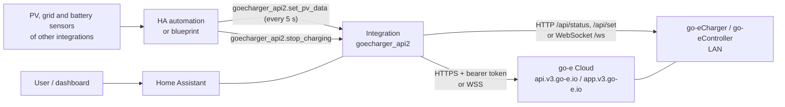

### 3.2 Technical context (interfaces)

| Channel | Direction | Protocol | Authentication |
|---|---|---|---|
| LAN polling | HA → wallbox | `GET http(s)://<host>/api/status?filter=…`, `GET …/api/set?key=value` | none (enabling "HTTP API v2" in the go-e app) |
| LAN WebSocket | HA ↔ wallbox | `ws(s)://<host>/ws`, JSON/MessagePack | challenge-response with PBKDF2-SHA512 or bcrypt, `securedMsg` with HMAC-SHA256 |
| Cloud polling | HA → cloud | `GET https://<serial>.api.v3.go-e.io/api/status`, `/api/set` | `Authorization: Bearer <token>` |
| Cloud WebSocket | HA ↔ cloud | `wss://app.v3.go-e.io/<serial>` | token header plus wallbox password challenge |
| HA services | automation → integration | `goecharger_api2.set_pv_data`, `goecharger_api2.stop_charging`, `goecharger_api2.set_temporary_current_limit` | HA permissions |
| Configuration | user → HA | config flow (create, reconfigure) | HA login |

[Code] The operating mode is **not** selected but follows from the configuration: if a password is stored in the config entry, the integration uses WebSocket, otherwise HTTP polling (`async_setup_entry` in `__init__.py`, `GoeChargerApiV2Bridge` in `pygoecharger_ha/__init__.py`).

### 3.3 Official interface documentation of go-e GmbH

Source: GitHub repository [`goecharger/go-eCharger-API-v2`](https://github.com/goecharger/go-eCharger-API-v2), state at commit `b4d7f85` of 2026-08-12. Status of the go-e services: https://status.go-e.com/status/go-e.

| Document | Content | Used by the integration? |
|---|---|---|
| `API_KEYS_FIRMWARE/apikeys-en.md` | All API keys with read/write, type, category, description (about 400 KB). Additional lists for firmware 59.4, 60.2, 60.3 and 60.4 | Yes, basis of `keys.py` and the filters |
| `http-en.md` | Local HTTP API: `/api/status` (optional `filter=`), `/api/set` | Yes (polling) |
| `cloudapi-en.md` | Cloud HTTP API via `https://<serial>.api.v3.go-e.io` with token | Yes (cloud polling) |
| `mqtt-en.md` | MQTT, writing only after explicit release since firmware 051.5 | No |
| `modbus-en.md`, `ocpp-en.md` | Modbus and OCPP | No |
| `gridapi-en.md` | "Coming soon", no content | No |
| `Changelogs_Gemini/`, `Changelogs_PRO/` | Firmware changes 60.3 to 60.5 | Only as background |

**Important:** A **WebSocket interface is not described in the official documentation.** The README of the integration calls it "undocumented". Login and message format are reverse engineered (observation of the app and of the Wattpilot project, see comments in `ws_connect` and `_ws_compute_hashed_password`). The preferred data path is therefore outside of what go-e guarantees (risk [R016](risks/R016-websocket-interface-is-not-officially-documented.md)).

**What the official documentation defines for the integration**

| Topic | Official statement | Relation to the integration |
|---|---|---|
| Local activation | The HTTP API must be enabled in the app (key `hai`) | README and config flow require this if no password is used for WebSocket |
| Full read | `/api/status` without filter: "higher system load, lots of traffic, shouldn't be used for productive setups" | The integration always uses `filter=…` (section 6.3), consistent with this |
| Filter | Comma-separated keys, since firmware 051.4. Before that a JSON list with about 10 entries | The integration uses only the new form; the README requires firmware 56.1 or later |
| Writing | Every value as a URL parameter, JSON-encoded (strings in quotes). Answer: `true` or an error message per key | Corresponds to `_write_values_int` (`'"'+str(value)+'"'`) |
| Calculation logic | The charging logic runs once per second, changed settings take effect after about one more second | Explains why writing and effect appear with a delay |
| PV data `ids` | `{"pGrid", "pPv", "pAkku"}`; `pGrid < 0` feed-in, `pAkku < 0` battery charging, `pPv > 0` generation, `pPv < 0` standby. "Needed all 5 seconds. Can be read back within 10 seconds after set." `pPv` and `pAkku` optional | Corresponds to the service `set_pv_data`; the UI limits `ppv` to values from 0 (`services.yaml`), although negative values mean "standby" according to the documentation |
| Cloud activation | Firmware 052 or later, app 2.3 or later; key `cae` or app switch | The integration reads `cae` in the config flow |
| Cloud token | Visible in the app or readable via key `cak`; a new token is created by setting `cak` | The integration does not request `cak` itself but stores the token in the config entry; the key can still appear in the WebSocket data |
| Cloud rate limit | None, but do not query more than once per second | Integration: cloud interval at least 30 s |
| Cloud `/api/status` | 403 offline or cloud API off; 404 no current data; 200 with data, header `last-modified`. Parameters `age` (default 30 s), `filter` | The integration evaluates only 200 and 400 and does not use `age` |
| Cloud `/api/set` | 403, 404 (charger offline), 422 (all keys rejected), **202** according to the documentation (at least one key sent, no guarantee); according to the maintainer the real cloud answers 200 and the documentation is wrong here | In `_write_values_int` the integration treats only 200 and 500 as an answer (risk [R015](risks/R015-cloud-documentation-names-http-202-for-api-set.md), not a defect) |

---

## 4. Solution strategy

| Goal | Approach | Where |
|---|---|---|
| Robustness | One `DataUpdateCoordinator` per config entry; error counter with a 2 minute block; delayed restart after more than 5 connection errors (1 to 5 minutes at random); WebSocket watchdog every 5 minutes 1 second | `__init__.py` |
| Freshness at low load | WebSocket push with debouncing (at least 1 second between HA updates, otherwise scan interval); in polling "hibernation" (only 6 keys as long as no vehicle is plugged in), configuration at most hourly | `pygoecharger_ha/__init__.py`, `const.py` (filters) |
| Little code per entity | Declarative entity descriptions in `const.py`; one generic class per platform that reads the value from the data store via `key`, `idx`, `tuple_idx`, `lookup`, `factor` | `const.py`, `sensor.py`, `number.py`, … |
| Firmware variety | Branches by device type (Core/Phoenix versus classic), firmware version (`cards` object versus single keys), keys present | `read_versions()`, `is_valid_charger_entity()` |
| PV surplus without hardware | Service `set_pv_data` writes the key `ids` with `pGrid`, `pPv`, `pAkku`; the blueprint supplies the measured values | `service.py`, `example/blueprint/` |
| Separation | Device protocol in the sub-library `pygoecharger_ha` (does not know Home Assistant but uses `aiohttp`, `msgpack`, `bcrypt`) | `pygoecharger_ha/` |

---

## 5. Building block view

### 5.1 Level 1: overall system

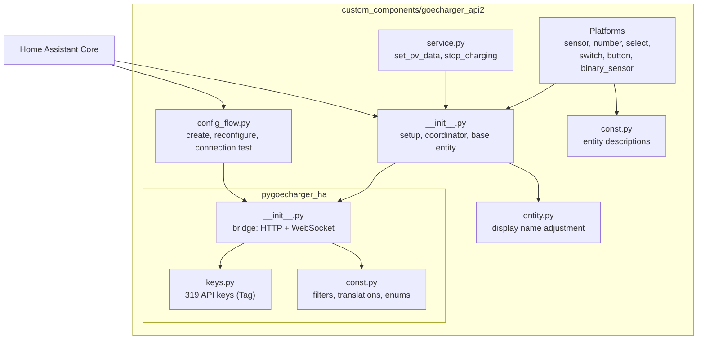

### 5.2 Level 2: building blocks

| Building block | Responsibility | Important points |
|---|---|---|
| `GoeChargerDataUpdateCoordinator` (`__init__.py`) | Holds bridge and data state per config entry; polling cycle; writes; error handling; WebSocket start and watchdog; device properties | `data` is a `ChainMap(_ws_states, _config, _states, _versions)`. Connection errors go through `_handle_client_connection_error`. |
| `GoeChargerApiV2Bridge` (`pygoecharger_ha/__init__.py`) | Converts between device and dictionary: reading with filter, writing, WebSocket handshake and messages | Chooses the path via `ws_connected`. Writing in WebSocket mode: sends the command and returns `{key: value}` (single write) or `{}` (multiple write) **before** the device has confirmed; the confirmation arrives later as `response`. In HTTP mode: result `{key: value}` or `{"err": …}`. |
| `GoeChargerBaseEntity` (`__init__.py`) | Common base: translation key, entity ID, `unique_id`, `device_info`, availability | Entity ID `…goe_<serial>_<key>` (LAN) or `…goe_wan_<serial>_…` (cloud). |
| `CustomFriendlyNameEntity` (`entity.py`) | Overrides the display name from HA 2026.2 on | Accesses the private method `_Entity__async_calculate_state`, so fragile with HA updates [Inference]. |
| Platforms | Create entities from the description lists; filter via `is_valid_charger_entity()` | Value access with `idx` (lists), `tuple_idx` (nested), `lookup` (number→text), `factor`, `differential_base_key`. |
| `service.py` | Three HA services | `set_pv_data`: grid power required, PV and battery optional. `stop_charging`: sets `frc=1`, waits 300 s, sets `frc=0` (both writes with acknowledgement, see 6.8). `set_temporary_current_limit`: sets `tcl` with acknowledgement (6.8). A registry of chargers (`add_config_entry_to_service`, `remove_config_entry_from_service`) maps `configid` to the coordinator; `get_coordinator` rejects unknown or disabled entries with `ServiceValidationError`. Without `configid` a charger is only chosen if exactly one is registered, otherwise there is also a `ServiceValidationError` (ADR-0010). |
| `config_flow.py` | Wizard LAN/cloud, connection test via WebSocket or HTTP, reconfiguration | Title and type from the device data that was read. |
| `const.py` / `pygoecharger_ha/const.py` | Entity descriptions; API filters (which keys for which cycle); translations; enums (`CAR_VALUES`, `CT_VALUES`) | The `FILTER_*` strings determine the amount of data per cycle. |
| `example/blueprint/…` | Blueprint for PV surplus | Own quality assurance in the blueprint (measurement check, target charger) since PR #171. |

### 5.3 State and data model (central)

| Store | Content | Filled by |
|---|---|---|
| `_versions` | System and version data (`typ`, `fwv`, `cards`, `cll`, …) | `read_versions()` |
| `_states` | Status values | Polling (`FILTER_ALL_STATES`, when idle `FILTER_MIN_STATES`) |
| `_config` | Configuration values | Polling at most hourly (`FILTER_ALL_CONFIG`) |
| `_ws_states` | Everything that arrives via WebSocket (full status, delta, answers) | WebSocket messages |

The order in the `ChainMap` gives WebSocket values priority. [Docs] The README says the configuration is read "every 24 hours"; the code says one hour (`__init__.py`/bridge `read_all`: `+ 3600`). Documentation and code therefore differ.

---

## 6. Runtime view

### 6.1 Start (setup)

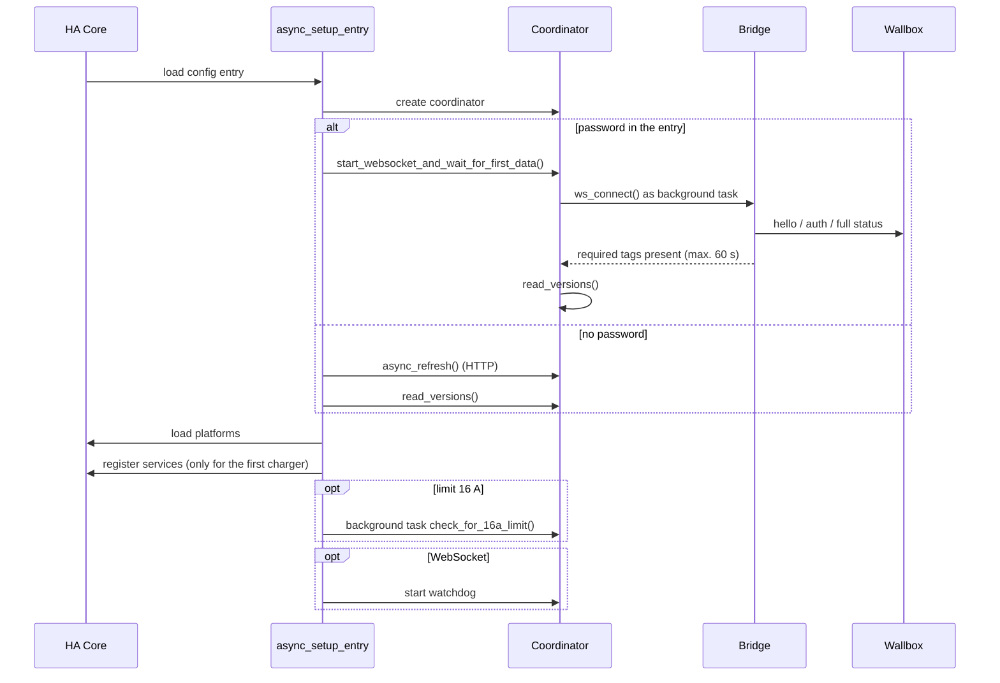

Errors during start lead to `ConfigEntryNotReady`; HA retries later by itself.

### 6.2 WebSocket connection and login [Code, `ws_connect`]

1. Connect to `ws_url` (and in the cloud case with the bearer token).
2. Receive `hello`: serial number, firmware, whether secured.
3. Receive `authRequired`: hash type (`pbkdf2` or `bcrypt`; chosen by device type if missing), `token1`, `token2`.
4. Compute the hashed password, create `token3`, send the answer hash (SHA-256 over `token3 + token2 + SHA256(token1 + password hash)`).
5. Wait for the result for up to 10 seconds. On success `ws_connected = True`.
6. Message loop: `fullStatus` (full or partial), `deltaStatus` (without the keys in `API_KEYS_TO_IGNORE_FROM_WS`), `response` (answer to a write command).
7. Every new message triggers a debounced update of the coordinator.

Write commands go out as `setValue` with a running `requestId`. In local secured mode the message is wrapped as `securedMsg` with HMAC.

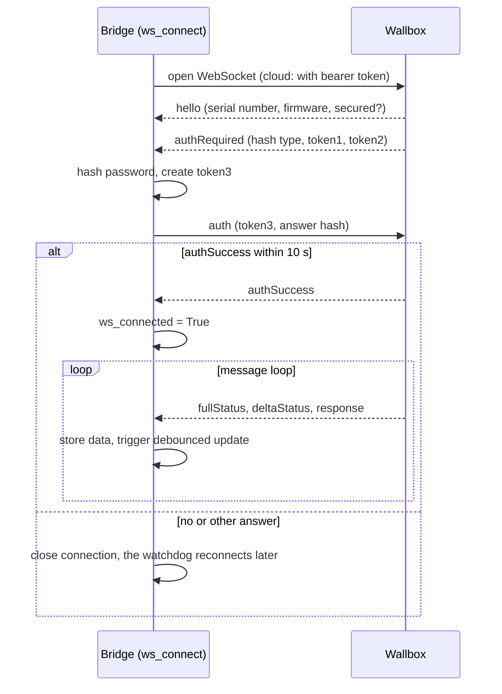

### 6.3 Polling cycle (without WebSocket)

- Interval: scan interval of the config entry (LAN default 30 s in the dialog, minimum 5 s; cloud at least 30 s, suggested 120 s).
- If no vehicle is connected (`car == 1`), only the keys `car, modelStatus, err, nrg, tcl, tma, trx` (plus time values and, after PV data, `pakku, ppv, pgrid`) are read, a full read every 5 minutes.
- As soon as `car` leaves idle, a full read follows at once.
- Configuration: at most hourly. If reading fails, it is retried after 5 minutes.

### 6.4 Writing a setting

1. The entity calls `coordinator.async_write_key(key, value, entity)`.
2. The coordinator checks the block after errors (2 minutes) and the restart state and otherwise raises `ValueError`.
3. Bridge: WebSocket → send and return `{key: value}` at once (multiple write: `{}`); the confirmation of the device arrives later as `response`. HTTP → `GET /api/set`, result `{key: value}` or `{"err": …}`.
4. `handle_write_result()` takes over the **requested** value into the data at once (also in WebSocket mode) and triggers an entity update. If the charger rejects the command, the value stays until the device reports the key again ([R026](risks/R026-rejected-value-stays-in-the-display.md)).

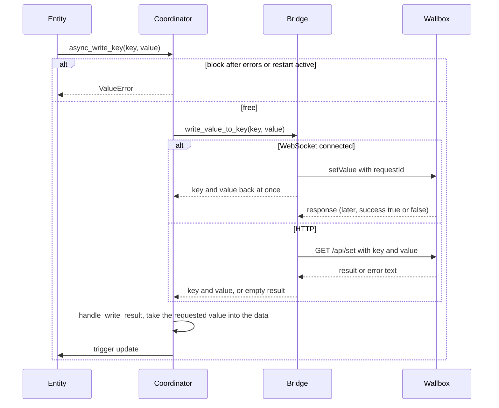

### 6.5 PV surplus (`set_pv_data`)

1. The blueprint calls the service every 5 seconds with `pgrid`, `ppv`, `pakku` (and `configid`; with several chargers it has been mandatory since `4702213`, see ADR-0010).
2. Cloud mode: if no vehicle is connected (`car < 2`), **nothing** is sent (load protection).
3. The service writes the key `ids` with `{"pGrid", "pPv", "pAkku"}`.
4. In HTTP mode the bridge then sets a flag so that `pakku, ppv, pgrid` are also read when idle.
5. If the automation stops sending, the wallbox keeps old values for 5 seconds [Docs]. That the moving averages of the wallbox (`pvopt_average…`) stand still afterwards was an assumption during blueprint development and has not been checked on the device. The blueprint handles the risk (unwanted grid charging) itself: when a used source is missing or invalid it skips the daylight update and does not command the charger to stop ([R023](risks/R023-blueprint-in-main-has-no-zero-value-branch-for-invalid.md)); at night and at sunset it sends zero values so that the wallbox does not work with stale averages.

### 6.6 Forced stop (`stop_charging`)

`frc=1` (charging off), wait 300 s, `frc=0`. Both writes have required an acknowledgement since `d876dfd` (`require_ack=True`, see 6.8). A second request during the waiting time is rejected (`_stop_in_progress`). Since `9e7d62a` the flag is reset in a `finally`, so also after a write error ([R001](risks/R001-stop-charging-locks-the-charger-after-a-write-error.md), fixed). The earlier `TypeError` in WebSocket mode is also fixed. The result of the unlock write (`frc=0`) is not checked: a failed or unconfirmed unlock leaves `frc=1` set and may still be reported as success ([R031](risks/R031-stop-charging-does-not-check-the-unlock-and-may-report.md)).

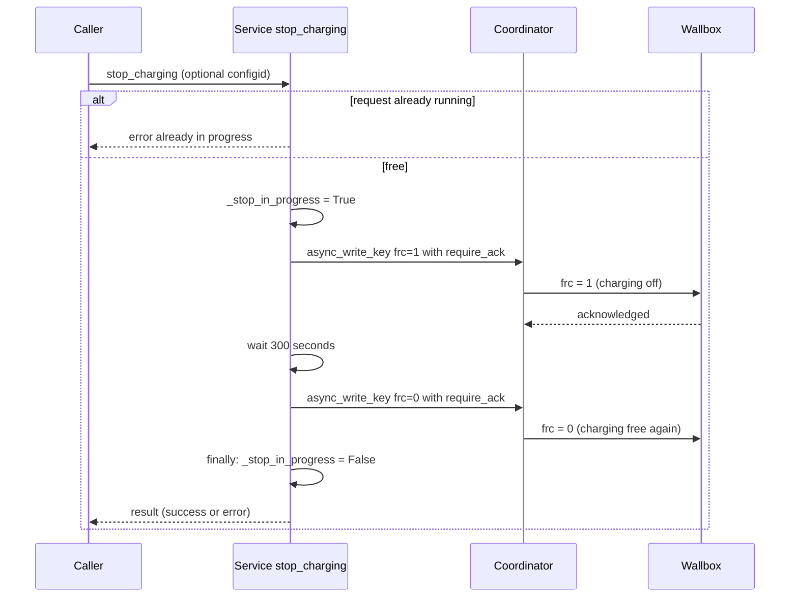

### 6.7 Error handling and restart

- `ClientConnectionError`: set timestamp and counter, no requests for 2 minutes, data stays as it is.
- More than 5 errors in a row: after a random wait of 1 to 5 minutes the config entry is reloaded.
- WebSocket watchdog (every 5 minutes and 1 second): reconnects if not connected; aborts and rebuilds if no data arrived for more than 50 seconds.
- `force_async_update_now()`: forces a WebSocket restart, but not in the first 5 minutes after start and not in the first 2 minutes after a fresh connection.

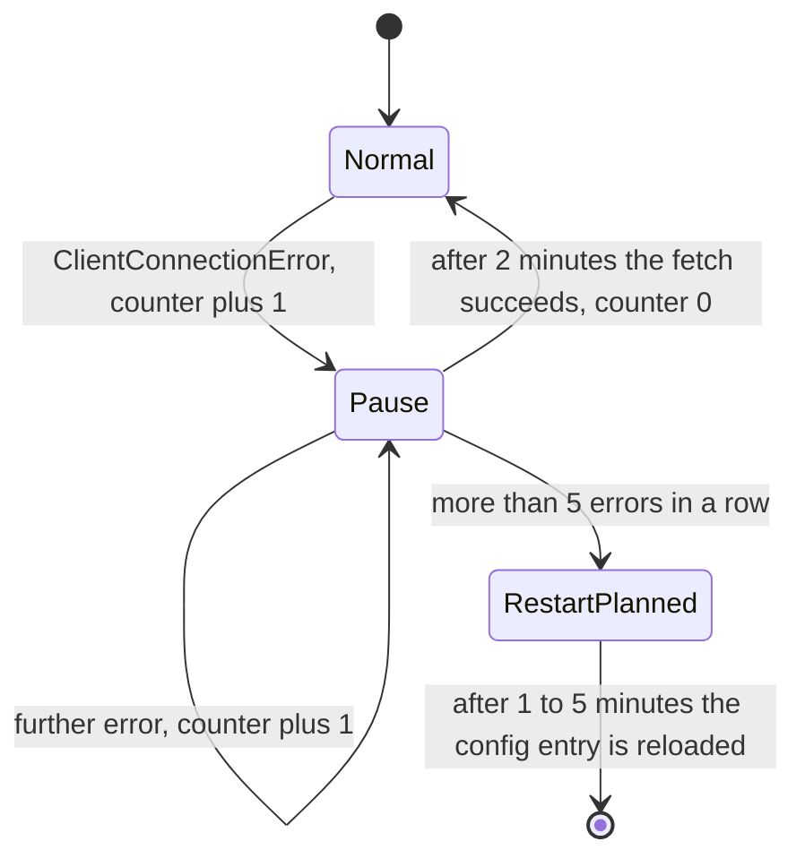

In `Pause` and `RestartPlanned`, `async_write_key` rejects writes with `ValueError` and the fetch skips the request.

### 6.8 Temporary current limit (`tcl`) and acknowledged writing [Code]

Since PR #177 there is the service `set_temporary_current_limit` (parameter `current`, optional `configid`) and a number entity for `tcl` (disabled by default, 6 to 32 A, with 16 A check).
1. **Input check** (`_TCLTagLogic` in `keys.py`): the device must report `tcl`, otherwise `ValueError`. Whole amperes only. The bounds come from `mca` (minimum), `ama` (maximum) and the variant `var` (11 or 22); the upper bound is 16 A for variant 11 or an active 16 A limit, otherwise 32 A. The service turns this into a `ServiceValidationError`.
2. **Acknowledged writing** (`require_ack=True`): in WebSocket mode `_ws_send_command` sends the command and waits up to 3 seconds for the `response` message with the matching `requestId`. On a secured connection only the inner answer counts, not the acknowledgement of the envelope (`securedMsg`). A timeout or `success` other than `true` leads to `{}` and thus to "not acknowledged". In HTTP mode the answer of the request itself counts; the parameter only acts on the WebSocket path [Inference].
3. **Output check:** `tcl_validate_output` requires that the returned value equals the sent one, otherwise `ValueError` ("did not acknowledge").
4. **Users:** besides `tcl`, both writes of `stop_charging` also use the acknowledgement.

A controller (`go-eController`) knows neither `tcl` nor `cll` [Docs, `go-eController-API`].

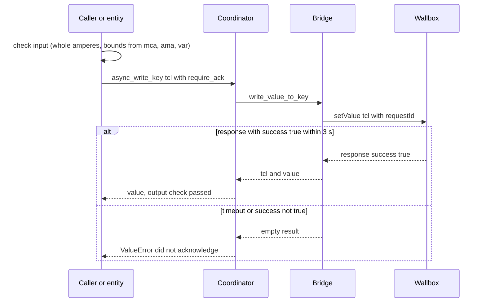

### 6.9 Choosing the charger for service calls [Code, `get_coordinator`]

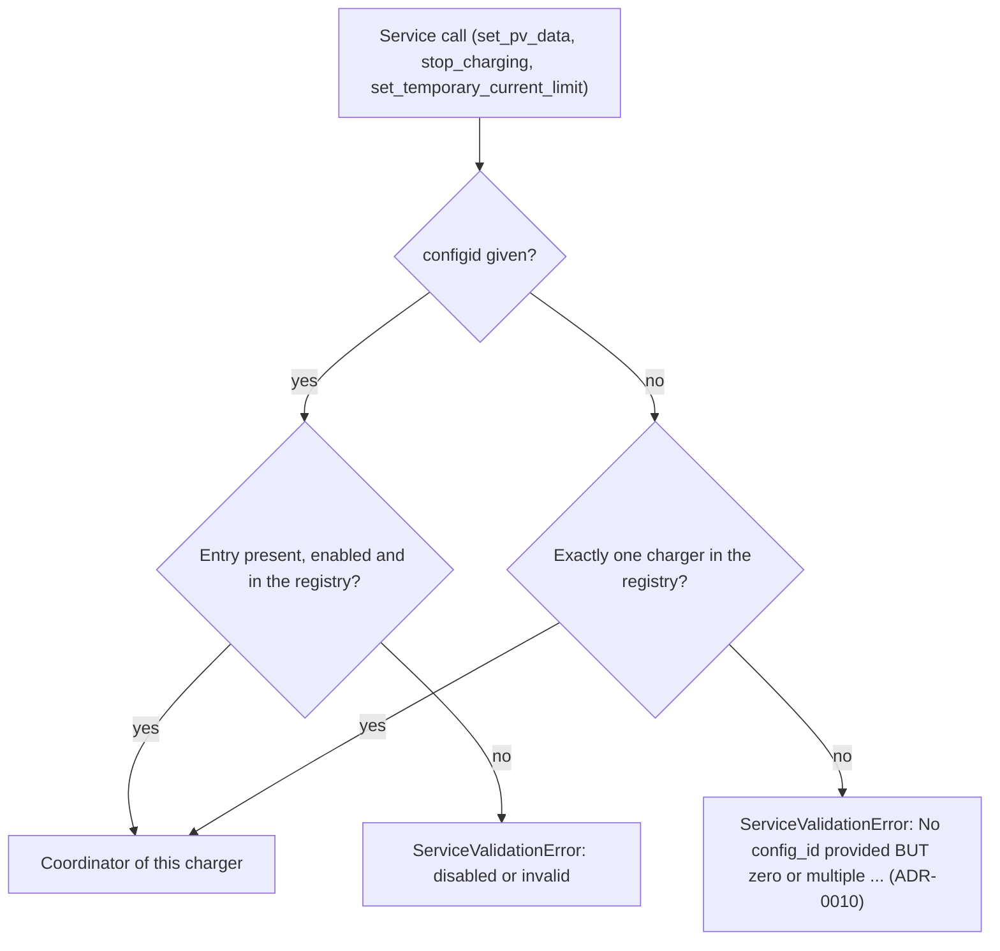

The registry contains chargers only ([R003](risks/R003-active-charger-counter-with-controller-entries.md), fixed). Controllers have no services.

### 6.10 Detection of the 16 A limit [Code, `read_versions`]

Chargers only. The result is `limit_to16a`; it limits sliders and services to at most 16 A.

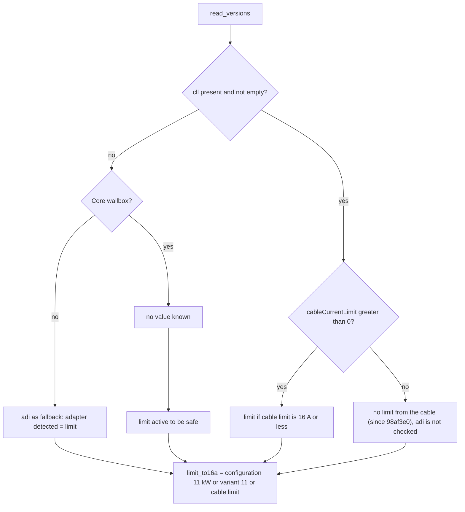

In addition: if the option "11 kW" is set in the config entry or the charger reports variant `var` = 11, the limit is always active. If evaluating `cableCurrentLimit` raises an error, the limit stays active for Core wallboxes. The model in the device gets the suffix "[16A limited]".

### 6.11 16 A limiter for existing settings [Code, `check_and_write_to_16a`]

Runs 15 seconds after start as a background task when `limit_to16a` applies.
1. From the entity registry, collect all enabled current entities of this entry with an upper bound of 16 A (disabled and orphaned ones are skipped).
2. Read their keys from the charger.
3. Cut values above 16 A to 16 A and write them back. `lot` is skipped if a load management group is set.
4. Errors are logged and not passed on.

### 6.12 Changing the vehicle type (multiple write) [Code, `select.py`]

When the user selects a vehicle type (`ct`), the integration writes several keys in one step with `async_write_multiple_keys`:

| Key | Value |
|---|---|
| `ct` | selected type |
| `mca` (minimum current) | 10 A for Renault Zoe, otherwise 6 A |
| `acp` (charge pause allowed) | off for VW ID.3 (variant 2), otherwise on |
| `su` (simulate unplugging briefly) | off for default, VW ID.3 (2), Dacia Spring and SsangYong, otherwise on |
| `psm` (phase switch mode) | 1 for Dacia Spring, otherwise 0 |
| `mcpd` (minimum pause between charges) | 120000 ms for Cupra Born (alternative), Ford Explorer, Porsche Taycan and Škoda Enyaq, otherwise 0 |

In WebSocket mode the bridge sends the keys one after another 0.75 seconds apart and then reports an empty result; the confirmation arrives through the status messages ([R027](risks/R027-false-error-after-a-successful-multiple-write.md), fixed). In HTTP mode everything goes in one request.

### 6.13 Setup in the config flow [Code, `config_flow.py`]

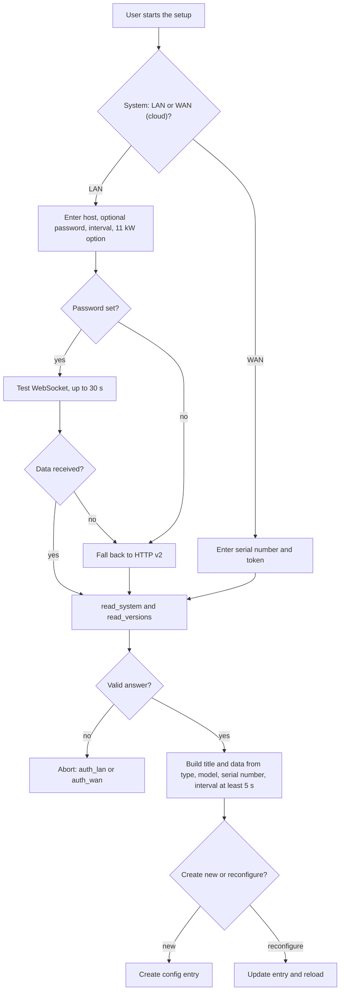

Note: `_abort_if_unique_id_configured()` is called, but no `unique_id` is set ([R006](risks/R006-no-unique-id-in-the-config-flow.md)). Creating the same device twice is therefore not prevented. Existing entries of an older version are migrated by `async_migrate_entry` when they are loaded (section 8.1).

---

## 7. Deployment view

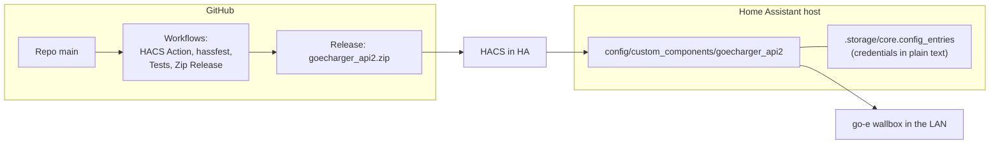

- **Build:** when a release is published, the workflow zips the folder `custom_components/goecharger_api2` [Code, `release.yaml`].
- **CI:** HACS Action and hassfest run on push, pull request and daily. Since PR #179 `tests.yaml` runs the tests on pushes to `main` and on pull requests [Code].
- **Operation:** runs inside the HA process, no services of its own. Credentials (password, cloud token) are in the HA config entry.

---

## 8. Cross-cutting concepts

### 8.1 Configuration and migration
- Config flow version 2.1. Data in `config_entry.data`, `options` stay empty.
- Migration from version 1 to 2 merges `options` into `data`. Migration from 2.0 deletes all devices of the entry so that they are created again with new identifiers [Code, `async_migrate_entry`].
- Device identifiers are `(DOMAIN, type, mode, serial number)`. Since `8cb62b2` the device info no longer contains a token.

### 8.2 Entities and names
- Translation key from API key plus index or suffix, `unique_id` = `goecharger_api2.<entity-id-part>`.
- Translations in `translations/{de,en,fr}.json`; in addition value texts (for example `car`) in `pygoecharger_ha/const.py` for German and English.

### 8.3 Device and firmware variants
- Core/Phoenix/Pro versus classic: different temperature sensors (`tma` index 2 to 5 versus 0 and 1), some unsupported entities, Core-only `iso2ena`, different hash type (bcrypt).
- 16 A limit: from cable limit (`cll.cableCurrentLimit`), adapter (`adi`), variant (`var == 11`) or option; sets `native_max_value` to 16 and writes values that are too high back at start. Since `98af3e0`: if `cll` has content but no `cableCurrentLimit`, **no** limit is set and `adi` is not consulted (assumption of the author: only Flex devices deliver this key; trigger was issue #176). Before that, Core devices without this key were limited to 16 A to be safe ([R029](risks/R029-without-cablecurrentlimit-there-is-no-limit-to-16-a-any.md)).
- `cards` as an object or as 30 single keys (firmware 60.0).

### 8.4 Error and log strategy
- Errors in bridge methods are mostly logged as a warning and returned as an empty result; write errors go to the calling entity as `ValueError`.
- Many broad `except BaseException`: 13 places in `custom_components/` [Code, counted]. They also catch `CancelledError` and `KeyboardInterrupt`.

### 8.5 Security
- **Credentials:** password and cloud token are in the HA config entry in plain text (HA provides no vault). At DEBUG level the WebSocket login writes a fragment of the hashed password (first and last three characters) to the log ([R008](risks/R008-credentials-are-stored-in-plain-text-in-the-config-entr.md)).
- **Trust boundary:** the LAN HTTP API has no authentication; protection lies in the network.

### 8.6 Concurrency
- One event loop; write commands over WebSocket wait 0.75 s each one after another for multiple writes.
- The global variable `SCAN_INTERVAL` is overwritten in the coordinator constructor (applies process-wide, so to all config entries) [Code, `__init__.py:331`].

### 8.7 Testing and quality assurance
- **In the repo (upstream):** HACS validation and hassfest. The earlier unit, integration and blueprint tests were deleted in `60d9a09`; since PR #178 (`738c3c6`) the regression tests are in `tests/integration`.
- **Regression tests (`tests/integration`, written in a fork):** 989 tests (420 per-key contract checks, 569 behaviour and error tests; 972 blocking, 17 intentionally red, with PR #180), line coverage 93 %, branch coverage 85 %, path coverage (upper bound) 61 %. A measurement report is created by hand with `test-report.yaml` (see test concept).
- **Test concept:** `docs/quality/testkonzept-ha-goecharger-api2.md` describes scope, levels, markers, state and gaps.
- **Contract with the official API:** in the repository `test_api_contract.py` checks whether every documented key is supported or explained (92 documented keys without a tag, 38 used keys without documentation, 14 deviations in write permission and category). The lists are in `tests/integration/contract/` (`classification.json`, `deviations.json`).

---

## 9. Architecture decisions

The decisions are separate documents in [`docs/architecture/adr/`](adr/README.md), one file per decision. ADR-0001 to ADR-0009 are reconstructed from code and comments [Inference]; ADR-0010 and ADR-0011 come from October 2026.

| ADR | Decision | Status |
|---|---|---|
| [ADR-0001](adr/0001-prefer-websocket-polling-as-fallback.md) | Prefer WebSocket, polling as fallback | Accepted (reconstructed, date unknown) |
| [ADR-0002](adr/0002-operating-mode-follows-from-the-password.md) | Operating mode follows from the password | Accepted (reconstructed, date unknown) |
| [ADR-0003](adr/0003-bridge-as-a-sub-library-in-the-same-folder.md) | Bridge as a sub-library in the same folder | Accepted (reconstructed, date unknown) |
| [ADR-0004](adr/0004-declarative-entity-descriptions.md) | Declarative entity descriptions | Accepted (reconstructed, date unknown) |
| [ADR-0005](adr/0005-own-chainmap-data-store-instead-of-a-type-model.md) | Own ChainMap data store instead of a type model | Accepted (reconstructed, date unknown) |
| [ADR-0006](adr/0006-hibernation-in-polling.md) | Hibernation in polling | Accepted (reconstructed, date unknown) |
| [ADR-0007](adr/0007-pv-data-through-an-ha-automation-instead-of-extra-hardware.md) | PV data through an HA automation instead of extra hardware | Accepted (reconstructed, date unknown) |
| [ADR-0008](adr/0008-restart-by-config-reload-on-persistent-errors.md) | Restart by config reload on persistent errors | Accepted (reconstructed, date unknown) |
| [ADR-0009](adr/0009-no-automated-tests-in-the-repository.md) | No automated tests in the repository | Superseded by ADR-0011 |
| [ADR-0010](adr/0010-service-calls-without-configid-only-with-exactly-one-charger.md) | Service calls without configid only with exactly one charger | Accepted (2026-10-29, commit `4702213`) |
| [ADR-0011](adr/0011-regression-tests-in-the-repository.md) | Regression tests in the repository | Accepted (2026-10-29, PRs #178 and #179) |

---

## 10. Quality requirements

### 10.1 Quality tree

```
Quality
├── Reliability
│   ├── Reconnecting (watchdog, reload)
│   ├── Firmware tolerance (switches by device type/version)
│   └── Behaviour on partial failure (keep data)
├── Efficiency
│   ├── Push instead of poll
│   └── Hibernation, staggered read cycles
├── Maintainability
│   ├── Declarative entities
│   └── (open) tests, typing
├── Security
│   ├── Credentials
│   └── Safe write paths (stop function)
└── Usability
    └── Setup through a dialog, translations
```

### 10.2 Quality scenarios

| ID | Scenario | Expectation | Current state |
|---|---|---|---|
| Q1 | Wallbox is gone from the WLAN for 10 minutes | No permanent load; automatic recovery | Error counter, 2 min block, reload after more than 5 errors [Code] |
| Q2 | Firmware update changes keys (60.0) | Integration keeps running | Switches for `cards` and `cll` exist [Code] |
| Q3 | PV automation fails | No unwanted grid charging | Lies in the blueprint; the integration checks inputs only for number and finiteness (`ppv`, `pakku`) |
| Q4 | `stop_charging` in WebSocket mode | Charging off for 5 min, then free again | **Met** since `03b0fc3` and `9e7d62a`: `frc=1`, wait, `frc=0`, the flag is always reset ([R001](risks/R001-stop-charging-locks-the-charger-after-a-write-error.md)). Earlier `TypeError`. Not checked on a device. |
| Q5 | Two chargers in one HA instance | Service acts on the chosen charger | **Met** with `configid`; without `configid` there is an error instead of a silent default ([R002](risks/R002-multi-charger-registry-incomplete.md) fixed, ADR-0010). Not checked on a device. |
| Q6 | User without admin rights | No credentials readable | The token has not been in the device info since `8cb62b2`. Password and token remain in the config entry (HA property). |

---

## 11. Risks and technical debt

The risks are in documents of their own: [risk register](risks/README.md), one document per risk (description, assessment, countermeasure, status, evidence) with an overview and a heat map. The open assumptions are listed there as well. References like [R015](risks/R015-cloud-documentation-names-http-202-for-api-set.md) in the text of this document link to the risk documents.

---

## 12. Glossary

| Term | Meaning |
|---|---|
| APIv2 | Second generation of the go-e device interface (HTTP and WebSocket) |
| `frc` | `forceState`: 0 neutral, 1 off, 2 on ("manual charging mode") |
| `ids` | Key for PV data (`pGrid`, `pPv`, `pAkku`) |
| `pgrid` | Power from the grid (positive) or into the grid (negative) in watts |
| `ppv` | PV generation in watts |
| `pakku` | Battery: negative charges, positive discharges |
| `car` | Vehicle state: 1 idle, 2 charging, 3 waiting, 4 finished, 5 error |
| `fup` / `lmo` | Use PV surplus / logic mode (ECO) |
| `hai` / `cae` | Local HTTP API allowed / cloud API allowed |
| Core/Phoenix | Newer wallbox hardware generation with partly different keys and bcrypt login |
| LAN / WAN | Local access / access through the go-e cloud (serial number plus token) |
| Hibernation | Polling power-saving mode without a connected vehicle |
| Coordinator | HA helper class that fetches data and distributes it to entities |
| Blueprint | Template for HA automations; here for PV surplus |

---

## Appendix: sources

**Official go-e documentation** (state at commit `b4d7f85`, 2026-08-12), repository `goecharger/go-eCharger-API-v2`:
- `README.md`, `introduction-en.md` (introduction and links)
- `API_KEYS_FIRMWARE/apikeys-en.md` (all keys) and the lists per firmware 59.4 to 60.4
- `http-en.md` (local HTTP API), `cloudapi-en.md` (cloud HTTP API)
- `mqtt-en.md`, `modbus-en.md`, `ocpp-en.md`, `gridapi-en.md` (not used)
- `Changelogs_Gemini/`, `Changelogs_PRO/` (firmware 60.3 to 60.5)
- Status page: https://status.go-e.com/status/go-e

**In the repository of the integration:**

- `custom_components/goecharger_api2/__init__.py`: setup, coordinator, base entity
- `custom_components/goecharger_api2/pygoecharger_ha/__init__.py`: bridge, WebSocket login
- `custom_components/goecharger_api2/service.py`, `services.yaml`: services
- `custom_components/goecharger_api2/config_flow.py`: setup
- `custom_components/goecharger_api2/const.py`, `pygoecharger_ha/const.py`, `keys.py`: descriptions, filters, keys
- `README.md`, `docs/PVSURPLUS.md`, `example/blueprint/automation/readme.md`
- `.github/workflows/*.yaml`, `hacs.json`, `manifest.json`
