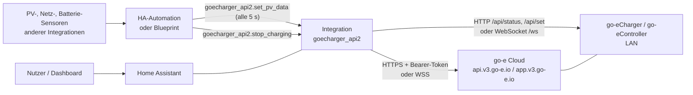
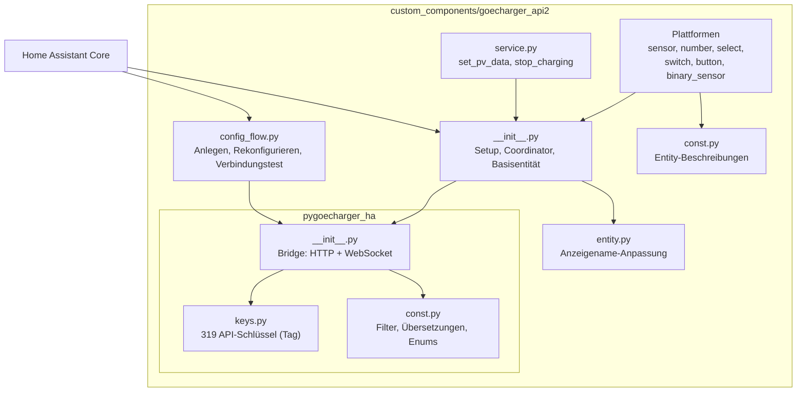
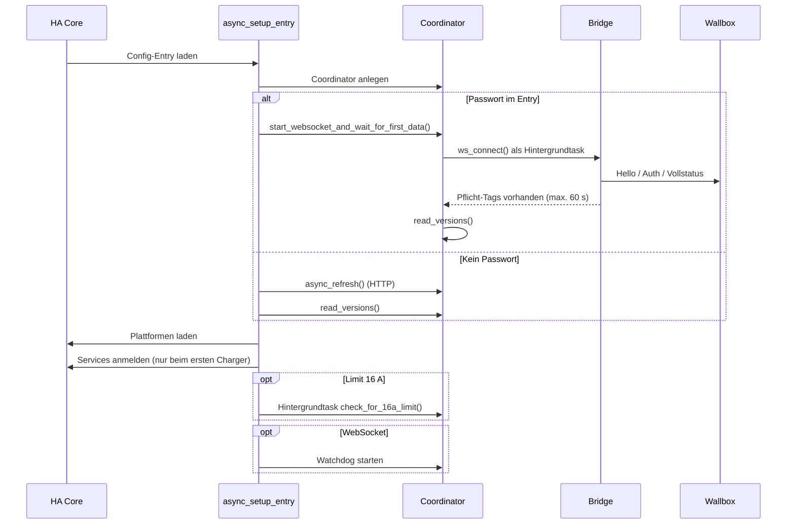
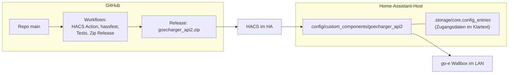

# arc42 – Architekturdokumentation: `ha-goecharger-api2` (go-e APIv2 Connect)

| | |
|---|---|
| **Gegenstand** | Home-Assistant-Integration `goecharger_api2` für go-eCharger-Wallboxen und go-eController |
| **Quelle** | `marq24/ha-goecharger-api2`, Branch `main`, Commit `98af3e0` (2026-10-28). Letzte Version (Release) ist `2026.10.8` (Commit `03b0fc3`, 2026-10-27); `main` enthält danach noch einen Commit zur 16-A-Erkennung. Risiken und Bausteine wurden am 2026-10-29 gegen diesen Stand aktualisiert |
| **Erstellt** | 2026-10-27, rekonstruiert aus Code, README, `docs/PVSURPLUS.md`, Workflows und Commit-Historie |
| **Status** | Arbeitsunterlage, mit KI-Unterstützung (Claude Code) erstellt und von Oliver geprüft. Kein Bestandteil des Upstream-Repositories; der Maintainer war an der Erstellung nicht beteiligt. |

**Lesehinweis zur Verlässlichkeit.** Aussagen sind in drei Stufen markiert:
- **[Code]**: direkt aus dem Quelltext gelesen, mit Datei und Zeile.
- **[Doku]**: steht so im README oder in `docs/`.
- **[Schluss]**: von mir abgeleitet (Absicht, Bewertung). Das ist keine Aussage des Autors.

Nichts davon wurde gegen einen laufenden Charger geprüft, außer wo ausdrücklich vermerkt.

---

## 1. Einführung und Ziele

### 1.1 Aufgabenstellung
Die Integration bindet go-eCharger-Wallboxen (und Wallboxen auf deren Hardwarebasis, zum Beispiel Fronius Wattpilot) sowie den go-eController in Home Assistant (HA) ein [Doku].

Sie liefert:
- **Lesen:** Status- und Konfigurationswerte als HA-Entitäten.
- **Schreiben:** Einstellungen der Wallbox aus HA heraus.
- **PV-Überschussladen ohne Zusatzhardware:** Eine HA-Automation schickt Netz-, PV- und Batterieleistung über einen Service an die Wallbox [Doku].

Umfang laut Code [Code, `const.py`]:

| Plattform | Charger | Controller |
|---|---|---|
| sensor | 103 | 74 |
| number | 36 | 0 |
| switch | 18 | 10 |
| binary_sensor | 16 | 0 |
| select | 15 | 6 |
| button | 3 | 1 |

Dazu 319 definierte API-Schlüssel (`Tag`) in `pygoecharger_ha/keys.py`. Die Zahlen sind gezählte `Ext*EntityDescription(`-Aufrufe und können durch bedingte Filterung (Abschnitt 5.2) zur Laufzeit niedriger liegen.

### 1.2 Qualitätsziele

| Prio | Ziel | Bedeutung hier |
|---|---|---|
| 1 | **Robustheit gegenüber Geräteverhalten** | Firmware ändert sich (55 bis 60.x), Verbindungen brechen ab, Wallboxen antworten unterschiedlich. Die Integration soll weiterlaufen. |
| 2 | **Aktualität bei geringer Last** | Push per WebSocket statt Polling; im Polling-Betrieb bewusst gedrosselt (Hibernation-Modus). |
| 3 | **Geringer Konfigurationsaufwand** | Alles über die HA-Oberfläche; Entitäten werden aus Beschreibungen erzeugt. |
| 4 | **Sicherer Betrieb der Steuerung** | Schreibzugriffe wirken auf ein physisches Gerät (Stromfluss, Fahrzeug). |

[Schluss] Die Reihenfolge ist aus dem Code abgeleitet (viel Aufwand bei Reconnect, Watchdog, Firmware-Weichen, wenig bei Tests und Eingabevalidierung).

### 1.3 Stakeholder

| Rolle | Erwartung |
|---|---|
| Endnutzer (HA-Betreiber) | Funktioniert nach Firmware-Updates, kein Log-Spam, PV-Laden stabil |
| Maintainer (marq24, s3ppo für den Controller) | Wartbar mit wenig Freizeit |
| Beitragende (zum Beispiel MrCodeLabs mit dem Blueprint) | Klare Erweiterungspunkte |
| go-e GmbH | Nicht beteiligt. Die Integration ist inoffiziell [Doku]. |

---

## 2. Randbedingungen

| Typ | Randbedingung |
|---|---|
| Plattform | Home Assistant, `hacs.json` verlangt mindestens `2023.8.0`; `requirements_dev.txt` zieht `homeassistant>=2024.8.2`. Der Code nutzt neuere APIs (zum Beispiel `async_update_reload_and_abort`, `_get_reconfigure_entry`). Die tatsächlich unterstützte Mindestversion ist nicht eindeutig [Schluss]. |
| Sprache/Laufzeit | Python, asynchron (`asyncio`, `aiohttp`) |
| Abhängigkeiten | `msgpack>=1.1.2` (manifest); im Code zusätzlich `bcrypt`, `packaging`, `awesomeversion`, `aiohttp` (kommen aus HA oder werden vorausgesetzt). `bcrypt` steht **nicht** im Manifest [Code]. |
| Geräte-API | Undokumentierte WebSocket-Schnittstelle (nachgebaut) und dokumentierte HTTP-API v2 der go-e GmbH |
| Verteilung | HACS (Zip-Release); Lizenz siehe `LICENSE` |
| Organisation | Ein Hauptautor, Freizeitprojekt. Keine automatisierten Tests im Upstream-Repository (die Tests aus PR #171 wurden wieder entfernt). |
| Gerätegrenzen | Die Wallbox verwirft PV-Daten nach 5 Sekunden [Doku]. Die Konfiguration wird im Polling nur selten gelesen. |

---

## 3. Kontextabgrenzung

### 3.1 Fachlicher Kontext



### 3.2 Technischer Kontext (Schnittstellen)

| Kanal | Richtung | Protokoll | Authentifizierung |
|---|---|---|---|
| LAN-Polling | HA → Wallbox | `GET http(s)://<host>/api/status?filter=…`, `GET …/api/set?key=value` | keine (Freischaltung „HTTP API v2“ in der go-e-App) |
| LAN-WebSocket | HA ↔ Wallbox | `ws(s)://<host>/ws`, JSON/MessagePack | Challenge-Response mit PBKDF2-SHA512 oder bcrypt, `securedMsg` mit HMAC-SHA256 |
| Cloud-Polling | HA → Cloud | `GET https://<serial>.api.v3.go-e.io/api/status`, `/api/set` | `Authorization: Bearer <Token>` |
| Cloud-WebSocket | HA ↔ Cloud | `wss://app.v3.go-e.io/<serial>` | Token-Header plus Wallbox-Passwort-Challenge |
| HA-Dienste | Automation → Integration | `goecharger_api2.set_pv_data`, `goecharger_api2.stop_charging` | HA-Berechtigungen |
| Konfiguration | Nutzer → HA | Config-Flow (Anlegen, Rekonfigurieren) | HA-Login |

[Code] Betriebsart wird **nicht** ausgewählt, sondern ergibt sich aus der Konfiguration: Ist im Config-Entry ein Passwort hinterlegt, nutzt die Integration WebSocket, sonst HTTP-Polling (`__init__.py:123`ff, `pygoecharger_ha/__init__.py:151`ff).

### 3.3 Offizielle Schnittstellendokumentation der go-e GmbH

Quelle: GitHub-Repository [`goecharger/go-eCharger-API-v2`](https://github.com/goecharger/go-eCharger-API-v2), Stand Commit `b4d7f85` vom 2026-08-12. Status der go-e-Dienste: https://status.go-e.com/status/go-e. Eine lokale Kopie der gelesenen Dateien liegt in `go-e-api-docs-b4d7f85/`.

| Dokument | Inhalt | Von der Integration genutzt? |
|---|---|---|
| `API_KEYS_FIRMWARE/apikeys-en.md` | Alle API-Schlüssel mit Lesen/Schreiben, Typ, Kategorie, Beschreibung (rund 400 KB). Zusätzlich eigene Listen für Firmware 59.4, 60.2, 60.3 und 60.4 | Ja, Grundlage von `keys.py` und den Filtern |
| `http-en.md` | Lokale HTTP-API: `/api/status` (optional `filter=`), `/api/set` | Ja (Polling) |
| `cloudapi-en.md` | Cloud-HTTP-API über `https://<Seriennummer>.api.v3.go-e.io` mit Token | Ja (Cloud-Polling) |
| `mqtt-en.md` | MQTT, ab Firmware 051.5 Schreiben nur nach ausdrücklicher Freigabe | Nein |
| `modbus-en.md`, `ocpp-en.md` | Modbus und OCPP | Nein |
| `gridapi-en.md` | „Coming soon“, ohne Inhalt | Nein |
| `Changelogs_Gemini/`, `Changelogs_PRO/` | Firmware-Änderungen 60.3 bis 60.5 | Nur als Hintergrund |

**Wichtig:** Eine **WebSocket-Schnittstelle ist in der offiziellen Dokumentation nicht beschrieben.** Das README der Integration nennt sie „undocumented“. Anmeldung und Nachrichtenformat sind nachgebaut (Beobachtung der App und des Wattpilot-Projekts, siehe Kommentare in `ws_connect` und `_ws_compute_hashed_password`). Damit liegt der bevorzugte Datenpfad außerhalb dessen, was go-e zusichert (Abschnitt 11, R16).

**Was die offizielle Doku für die Integration festlegt**

| Thema | Offizielle Aussage | Bezug zur Integration |
|---|---|---|
| Aktivierung lokal | HTTP-API muss in der App aktiviert sein (Schlüssel `hai`) | README und Config-Flow verlangen das, falls kein Passwort für WebSocket genutzt wird |
| Gesamtabzug | `/api/status` ohne Filter: „higher system load, lots of traffic, shouldn't be used for productive setups“ | Integration nutzt immer `filter=…` (Abschnitt 6.3), passt dazu |
| Filter | Komma-getrennte Schlüssel, ab Firmware 051.4. Davor eine JSON-Liste mit rund 10 Einträgen | Integration verwendet nur die neue Form; das README fordert Firmware ab 56.1 |
| Schreiben | Jeder Wert als URL-Parameter, JSON-kodiert (Zeichenketten in Anführungszeichen). Antwort: je Schlüssel `true` oder eine Fehlermeldung | Entspricht `_write_values_int` (`'"'+str(value)+'"'`) |
| Rechenlogik | Die Lade-Logik läuft einmal pro Sekunde, geänderte Einstellungen wirken nach etwa einer weiteren Sekunde | Erklärt, warum Schreiben und Wirkung zeitversetzt erscheinen |
| PV-Daten `ids` | `{"pGrid", "pPv", "pAkku"}`; `pGrid < 0` Einspeisung, `pAkku < 0` Batterie lädt, `pPv > 0` Erzeugung, `pPv < 0` Standby. „Needed all 5 seconds. Can be read back within 10 seconds after set.“ `pPv` und `pAkku` optional | Entspricht dem Dienst `set_pv_data`; die Oberfläche begrenzt `ppv` auf Werte ab 0 (`services.yaml`), obwohl negative Werte laut Doku „Standby“ bedeuten |
| Cloud-Aktivierung | Firmware ab 052, App ab 2.3; Schlüssel `cae` oder App-Schalter | Integration liest `cae` im Config-Flow |
| Cloud-Token | In der App sichtbar oder über den Schlüssel `cak` lesbar; neuer Token durch Setzen von `cak` | Integration liest `cak` nicht, speichert aber den Token im Config-Entry |
| Cloud-Rate-Limit | Keins, aber nicht öfter als einmal pro Sekunde abfragen | Integration: Cloud-Intervall mindestens 30 s |
| Cloud `/api/status` | 403 offline oder Cloud-API aus; 404 keine aktuellen Daten; 200 mit Daten, Header `last-modified`. Parameter `age` (Standard 30 s), `filter` | Integration wertet nur 200 und 400 aus und nutzt `age` nicht |
| Cloud `/api/set` | 403, 404 (Charger offline), 422 (alle Schlüssel abgelehnt), **202** laut Doku (mindestens ein Schlüssel gesendet, ohne Garantie); laut Maintainer liefert die echte Cloud 200 und die Doku ist hier falsch | Integration behandelt in `_write_values_int` nur 200 und 500 als Antwort (Abschnitt 11, R15, kein Fehler) |

---

## 4. Lösungsstrategie

| Ziel | Ansatz | Wo |
|---|---|---|
| Robustheit | Pro Config-Entry ein `DataUpdateCoordinator`; Fehlerzähler mit 2 Minuten Sperre; nach mehr als 5 Verbindungsfehlern verzögerter Neustart (1 bis 5 Minuten zufällig); WebSocket-Watchdog alle 5 Minuten 1 Sekunde | `__init__.py` |
| Aktualität bei geringer Last | WebSocket-Push mit Entprellung (mindestens 1 Sekunde zwischen HA-Updates, sonst Scan-Intervall); im Polling: „Hibernation“ (nur 6 Schlüssel, solange kein Fahrzeug steckt), Konfiguration höchstens stündlich | `pygoecharger_ha/__init__.py`, `const.py` (Filter) |
| Wenig Code pro Entität | Deklarative Entity-Descriptions in `const.py`; je Plattform eine generische Klasse, die über `key`, `idx`, `tuple_idx`, `lookup`, `factor` den Wert aus dem Datenspeicher liest | `const.py`, `sensor.py`, `number.py`, … |
| Firmware-Vielfalt | Verzweigungen nach Gerätetyp (Core/Phoenix gegenüber klassisch), Firmware-Version (`cards`-Objekt gegenüber Einzelschlüsseln), vorhandenen Schlüsseln | `read_versions()`, `is_valid_charger_entity()` |
| PV-Überschuss ohne Hardware | Service `set_pv_data` schreibt den Schlüssel `ids` mit `pGrid`, `pPv`, `pAkku`; der Blueprint liefert die Messwerte | `service.py`, `example/blueprint/` |
| Trennung | Geräte-Protokoll in der Teilbibliothek `pygoecharger_ha` (kennt Home Assistant nicht, nutzt aber `aiohttp`, `msgpack`, `bcrypt`) | `pygoecharger_ha/` |

---

## 5. Bausteinsicht

### 5.1 Ebene 1: Gesamtsystem



### 5.2 Ebene 2: Bausteine

| Baustein | Verantwortung | Wichtige Punkte |
|---|---|---|
| `GoeChargerDataUpdateCoordinator` (`__init__.py`) | Hält Bridge und Datenzustand je Config-Entry; Polling-Zyklus; Schreibzugriffe; Fehlerbehandlung; WebSocket-Start und Watchdog; Gerätemerkmale | `data` ist eine `ChainMap(_ws_states, _config, _states, _versions)`. Verbindungsfehler gehen über `_handle_client_connection_error`. |
| `GoeChargerApiV2Bridge` (`pygoecharger_ha/__init__.py`) | Wandelt zwischen Gerät und Dictionary: Lesen mit Filter, Schreiben, WebSocket-Handshake und -Nachrichten | Wählt Pfad über `ws_connected`. Schreiben im WebSocket-Modus: sendet den Befehl und gibt `{key: value}` zurück (Einzelschreiben) oder `{}` (Mehrfachschreiben), **bevor** das Gerät bestätigt hat; die Bestätigung kommt später als `response`. Im HTTP-Modus: Ergebnis `{key: value}` oder `{"err": …}`. |
| `GoeChargerBaseEntity` (`__init__.py`) | Gemeinsame Basis: Übersetzungsschlüssel, Entity-ID, `unique_id`, `device_info`, Verfügbarkeit | Entity-ID `…goe_<serial>_<schlüssel>` (LAN) oder `…goe_wan_<serial>_…` (Cloud). |
| `CustomFriendlyNameEntity` (`entity.py`) | Überschreibt den Anzeigenamen ab HA 2026.2 | Greift auf die private Methode `_Entity__async_calculate_state` zu, also fragil bei HA-Updates [Schluss]. |
| Plattformen | Legen Entitäten aus den Beschreibungslisten an; filtern über `is_valid_charger_entity()` | Wertzugriff mit `idx` (Listen), `tuple_idx` (verschachtelt), `lookup` (Zahl→Text), `factor`, `differential_base_key`. |
| `service.py` | Zwei HA-Dienste | `set_pv_data`: Netzleistung Pflicht, PV und Batterie optional. `stop_charging`: setzt `frc=1`, wartet 300 s, setzt `frc=0`. Ein Register der Charger (`add_config_entry_to_service`, `remove_config_entry_from_service`) bildet `configid` auf den Koordinator ab; `get_coordinator` lehnt unbekannte oder deaktivierte Entries mit `ServiceValidationError` ab. Ohne `configid` wird nur dann ein Charger gewählt, wenn genau einer registriert ist, sonst folgt ebenfalls ein `ServiceValidationError` (E10). |
| `config_flow.py` | Assistent LAN/Cloud, Verbindungstest über WebSocket oder HTTP, Rekonfiguration | Titel und Typ aus den gelesenen Gerätedaten. |
| `const.py` / `pygoecharger_ha/const.py` | Entity-Beschreibungen; API-Filter (welche Schlüssel für welchen Zyklus); Übersetzungen; Enums (`CAR_VALUES`, `CT_VALUES`) | `FILTER_*`-Zeichenketten bestimmen den Datenumfang je Zyklus. |
| `example/blueprint/…` | Blueprint für den PV-Überschuss | Eigene Qualitätssicherung im Blueprint (Messwertprüfung, Zielcharger) seit PR #171. |

### 5.3 Zustand und Datenmodell (zentral)

| Speicher | Inhalt | Wird gefüllt durch |
|---|---|---|
| `_versions` | System- und Versionsdaten (`typ`, `fwv`, `cards`, `cll`, …) | `read_versions()` |
| `_states` | Statuswerte | Polling (`FILTER_ALL_STATES`, im Leerlauf `FILTER_MIN_STATES`) |
| `_config` | Konfigurationswerte | Polling höchstens stündlich (`FILTER_ALL_CONFIG`) |
| `_ws_states` | Alles, was per WebSocket ankommt (Vollstatus, Delta, Antworten) | WebSocket-Nachrichten |

Die Reihenfolge in der `ChainMap` gibt WebSocket-Werten Vorrang. [Doku] Das README nennt für die Konfiguration „alle 24 Stunden“; im Code steht eine Stunde (`__init__.py`/Bridge `read_all`: `+ 3600`). Die Dokumentation und der Code weichen also voneinander ab.

---

## 6. Laufzeitsicht

### 6.1 Start (Setup)



Fehler beim Start führen zu `ConfigEntryNotReady`; HA wiederholt das später selbst.

### 6.2 WebSocket-Verbindung und Anmeldung [Code, `ws_connect`]

1. Verbinden mit `ws_url` (und im Cloud-Fall mit dem Bearer-Token).
2. `hello` empfangen: Seriennummer, Firmware, ob gesichert.
3. `authRequired` empfangen: Hash-Typ (`pbkdf2` oder `bcrypt`; bei fehlender Angabe nach Gerätetyp gewählt), `token1`, `token2`.
4. Gehashtes Passwort berechnen, `token3` erzeugen, Antwort-Hash senden (SHA-256 über `token3 + token2 + SHA256(token1 + Passwort-Hash)`).
5. Ergebnis innerhalb von 10 Sekunden abwarten. Bei Erfolg `ws_connected = True`.
6. Nachrichtenschleife: `fullStatus` (voll oder teilweise), `deltaStatus` (ohne die Schlüssel in `API_KEYS_TO_IGNORE_FROM_WS`), `response` (Antwort auf Schreibbefehl).
7. Jede neue Nachricht stößt eine entprellte Aktualisierung des Koordinators an.

Schreibbefehle gehen als `setValue` mit fortlaufender `requestId`. Im lokalen gesicherten Modus wird die Nachricht als `securedMsg` mit HMAC verpackt.

### 6.3 Polling-Zyklus (ohne WebSocket)

- Intervall: Scan-Intervall des Config-Entry (LAN Standard 30 s im Dialog, Minimum 5 s; Cloud mindestens 30 s, vorgeschlagen 120 s).
- Ist ein Fahrzeug nicht angeschlossen (`car == 1`), werden nur die Schlüssel `car, modelStatus, err, nrg, tma, trx` (plus Zeitwerte und, nach PV-Daten, `pakku, ppv, pgrid`) gelesen, ein Vollabzug alle 5 Minuten.
- Sobald `car` vom Leerlauf abweicht, folgt sofort ein Vollabzug.
- Konfiguration: höchstens stündlich. Misslingt das Lesen, wird nach 5 Minuten neu versucht.

### 6.4 Schreiben einer Einstellung

1. Entität ruft `coordinator.async_write_key(key, value, entity)`.
2. Der Koordinator prüft Sperre nach Fehlern (2 Minuten) und Neustartzustand und wirft sonst `ValueError`.
3. Bridge: WebSocket → senden und sofort `{key: value}` zurückgeben (Mehrfachschreiben: `{}`); die Bestätigung des Geräts kommt später als `response`. HTTP → `GET /api/set`, Ergebnis `{key: value}` oder `{"err": …}`.
4. `handle_write_result()` übernimmt den **gewünschten** Wert sofort in die Daten (auch im WebSocket-Modus) und stößt eine Entitätsaktualisierung an. Lehnt der Charger den Befehl ab, bleibt der Wert, bis das Gerät den Schlüssel erneut meldet (R26).

### 6.5 PV-Überschuss (`set_pv_data`)

1. Blueprint ruft alle 5 Sekunden den Dienst mit `pgrid`, `ppv`, `pakku` auf (und `configid`; bei mehreren Chargern ist sie seit `4702213` Pflicht, siehe E10).
2. Cloud-Betrieb: Ist kein Fahrzeug verbunden (`car < 2`), wird **nichts** gesendet (Last-Schutz).
3. Der Dienst schreibt den Schlüssel `ids` mit `{"pGrid", "pPv", "pAkku"}`.
4. Im HTTP-Betrieb setzt die Bridge danach ein Flag, damit im Leerlauf zusätzlich `pakku, ppv, pgrid` gelesen werden.
5. Sendet die Automation nicht mehr, hält die Wallbox 5 Sekunden lang alte Werte [Doku]. Dass danach die gleitenden Mittelwerte der Wallbox (`pvopt_average…`) stehen bleiben, war unsere Annahme bei der Blueprint-Entwicklung und ist am Gerät nicht geprüft. Das Risiko (ungewolltes Netzladen) deckt das Blueprint durch sein Verhalten bei ungültigen Messwerten ab (Standard: Nullwerte senden).

### 6.6 Zwangs-Stopp (`stop_charging`)

`frc=1` (Laden aus), 300 s warten, `frc=0`. Eine zweite Anfrage während der Wartezeit wird abgewiesen (`_stop_in_progress`). Seit Version 2026.10.8 läuft der Ablauf auch im WebSocket-Modus durch (der frühere `TypeError` ist behoben). Das Flag wird allerdings bei einem Schreibfehler nicht zurückgesetzt: Schlägt `frc=1` oder nach der Wartezeit `frc=0` fehl, sind weitere Stopp-Anfragen bis zum Neuanlegen des Dienstes gesperrt (R1, Rest).

### 6.7 Fehlerbehandlung und Neustart

- `ClientConnectionError`: Zeitstempel und Zähler setzen, 2 Minuten lang keine Anfragen, Daten bleiben stehen.
- Mehr als 5 Fehler in Folge: nach 1 bis 5 Minuten Zufallswartezeit wird der Config-Entry neu geladen.
- WebSocket-Watchdog (alle 5 min 1 s): verbindet neu, wenn nicht verbunden; bricht ab und baut neu auf, wenn seit mehr als 50 Sekunden keine Daten kamen.
- `force_async_update_now()`: erzwingt WebSocket-Neustart, aber nicht in den ersten 5 Minuten nach Start und nicht in den ersten 2 Minuten nach einer frischen Verbindung.

---

## 7. Verteilungssicht



- **Build:** Beim Veröffentlichen eines Releases zippt der Workflow den Ordner `custom_components/goecharger_api2` [Code, `release.yaml`].
- **CI:** HACS Action und hassfest laufen bei Push, Pull Request und täglich. Seit PR #179 führt `tests.yaml` die Tests bei Push auf `main` und bei Pull Requests aus [Code].
- **Betrieb:** Läuft im HA-Prozess, keine eigenen Dienste. Zugangsdaten (Passwort, Cloud-Token) liegen im Config-Entry von HA.

---

## 8. Querschnittliche Konzepte

### 8.1 Konfiguration und Migration
- Config-Flow-Version 2.1. Daten in `config_entry.data`, `options` bleiben leer.
- Migration von Version 1 nach 2 führt `options` in `data` zusammen. Migration von 2.0 löscht alle Geräte des Entries, damit sie mit neuen Identifiern neu entstehen [Code, `async_migrate_entry`].
- Gerät-Identifier sind `(DOMAIN, Typ, Modus, Seriennummer)`. Seit `8cb62b2` enthält die Geräteinfo keinen Token mehr.

### 8.2 Entitäten und Namen
- Übersetzungsschlüssel aus API-Schlüssel plus Index oder Zusatz, `unique_id` = `goecharger_api2.<entity-id-teil>`.
- Übersetzungen in `translations/{de,en,fr}.json`; zusätzlich Wert-Texte (zum Beispiel `car`) in `pygoecharger_ha/const.py` für Deutsch und Englisch.

### 8.3 Geräte- und Firmware-Varianten
- Core/Phoenix/Pro gegenüber klassisch: unterschiedliche Temperatursensoren (`tma` Index 2 bis 5 gegenüber 0 und 1), einzelne nicht unterstützte Entitäten, Core-exklusives `iso2ena`, anderer Hash-Typ (bcrypt).
- 16-A-Begrenzung: aus Kabelgrenze (`cll.cableCurrentLimit`), Adapter (`adi`), Variante (`var == 11`) oder Option; setzt `native_max_value` auf 16 und schreibt beim Start zu hohe Werte zurück. Seit `98af3e0` gilt: Hat `cll` Inhalt, aber keinen `cableCurrentLimit`, wird **keine** Grenze gesetzt und `adi` nicht herangezogen (Annahme des Autors: nur Flex-Geräte liefern diesen Schlüssel; Anlass war Issue #176). Davor galt bei Core-Geräten ohne diesen Schlüssel vorsichtshalber 16 A (R29).
- `cards` als Objekt oder als 30 Einzelschlüssel (Firmware 60.0).

### 8.4 Fehler- und Logstrategie
- Fehler in Bridge-Methoden werden meist als Warnung geloggt und als leeres Ergebnis zurückgegeben; Schreibfehler als `ValueError` an die aufrufende Entität.
- Viele breite `except BaseException`: 13 Stellen in `custom_components/` [Code, gezählt]. Sie fangen auch `CancelledError` und `KeyboardInterrupt`.

### 8.5 Sicherheit
- **Zugangsdaten:** Passwort und Cloud-Token liegen im HA-Config-Entry im Klartext (HA stellt keinen Tresor bereit). Weitere Beobachtungen zu Zugangsdaten wurden dem Maintainer direkt mitgeteilt und sind hier bewusst nicht aufgeführt.
- **Vertrauensgrenze:** Das LAN-HTTP-API hat keine Authentifizierung; Schutz liegt im Netz.

### 8.6 Nebenläufigkeit
- Ein Event-Loop; Schreibbefehle über WebSocket warten je 0,75 s nacheinander bei Mehrfachschreiben.
- Globale Variable `SCAN_INTERVAL` wird im Koordinator-Konstruktor überschrieben (gilt prozessweit, also für alle Config-Entries) [Code, `__init__.py:331`].

### 8.7 Test und Qualitätssicherung
- **Im Repo (Upstream):** HACS-Validierung und hassfest. Die früheren Unit-, Integrations- und Blueprint-Tests wurden in `60d9a09` gelöscht; seit PR #178 (`738c3c6`) liegen die Regressionstests in `tests/integration`.
- **Regressionstests (`tests/integration`, entstanden im Fork, Branch `tests/regression-suite`):** 989 Tests (420 Vertragsprüfungen je Schlüssel, 569 Verhaltens- und Fehlertests; 972 blockierend, 17 beabsichtigt rot, mit PR #180), Zeilenabdeckung 93 %, Zweigabdeckung 85 %, Pfadabdeckung (obere Schranke) 61 %. Ein Messbericht entsteht von Hand über `test-report.yaml` (siehe Testkonzept).
- **Testkonzept:** `docs/quality/testkonzept-ha-goecharger-api2.md` beschreibt Umfang, Stufen, Marker, Stand und Lücken.
- **Vertrag zur offiziellen API:** Im Repository prüft `test_api_contract.py`, ob jeder dokumentierte Schlüssel unterstützt oder erklärt ist (92 dokumentierte Schlüssel ohne Tag, 38 genutzte Schlüssel ohne Doku, 14 Abweichungen bei Schreibrecht und Kategorie). Die Listen stehen in `tests/integration/contract/` (`classification.json`, `deviations.json`).
- **Lokal (nicht im Repo):** Unser Fork enthält Blueprint-Tests (240 Fälle) und Integrationstests (12 Fälle) als Arbeitsmittel (`OliEder/ha-goecharger-api2`, Branches `proposal/invalid-data-policy` und `fix/small-bugs`).

---

## 9. Architekturentscheidungen

Der Autor führt keine Entscheidungsprotokolle. Die folgenden Einträge sind aus Code und Kommentaren rekonstruiert [Schluss].

| # | Entscheidung | Begründung (abgeleitet) | Konsequenz |
|---|---|---|---|
| E1 | WebSocket bevorzugen, Polling als Rückfall | Effizienz; einige Geräte (Wattpilot) bieten kein HTTP-API [Doku] | Zwei Datenpfade mit unterschiedlichem Schreibergebnis (`None` gegenüber Dictionary) |
| E2 | Betriebsart = Passwort gesetzt | Einfache Einrichtung | Kein expliziter Schalter; Umschalten nur über Rekonfiguration |
| E3 | Eine Bridge-Teilbibliothek im selben Ordner | Trennung von Protokoll und HA | Nicht separat veröffentlicht; Abhängigkeiten nicht im Manifest vollständig |
| E4 | Deklarative Entity-Beschreibungen | Hunderte Entitäten mit wenig Code | Sehr große `const.py` (3300 Zeilen); Logik versteckt in Optionen (`idx`, `tuple_idx`) |
| E5 | Eigene `ChainMap`-Datenhaltung statt Typmodell | Schnelle Anpassung an neue Schlüssel | Kein Schema; Fehler zeigen sich erst zur Laufzeit (`KeyError` werden abgefangen) |
| E6 | Hibernation im Polling | Geräte- und Cloud-Last senken | Im Leerlauf nur wenige Werte aktuell |
| E7 | PV-Daten über HA-Automation statt Zusatzhardware | Kein Zusatzgerät nötig | Qualität liegt im Blueprint und in den Messwerten des Nutzers |
| E8 | Neustart per Konfigurations-Reload bei dauerhaften Fehlern | Hängende Verbindung selbst heilen | Reload aller Entitäten für ein Verbindungsproblem |
| E9 | Keine automatisierten Tests im Repo (überholt: seit PR #178, `738c3c6`, liegen die Tests in `tests/integration`) | Aufwand/Haltung des Autors | Vorher fielen Regressionen erst bei Nutzern auf; jetzt prüft die Suite jede Änderung gegen den Vertrag zur offiziellen API |
| E10 | Dienste (`set_pv_data`, `stop_charging`) ohne `configid`: nur bei genau einem registrierten Charger wird dieser verwendet, sonst `ServiceValidationError` (Commit `4702213`, 2026-10-29; Entscheidung des Maintainers im Code, im Issue #172 nicht begründet) | Vorher wurde der zuerst registrierte Charger genommen. Nach dem Neuladen eines Entries rückte dieser ans Ende der Liste, der Standard wechselte dann stillschweigend auf einen anderen Charger. Ein falscher Charger bei Schreibzugriffen (Strom, Stopp) wird vermieden [Schluss, aus Diff und Testfund]. | **Verhaltensänderung:** Wer mehrere Charger hat und `configid` bisher wegließ (zum Beispiel ein Blueprint oder eine Automation), bekommt jetzt einen Fehler statt eines Zugriffs auf den ersten Charger. Mit einem Charger oder mit `configid` ändert sich nichts. Alternativen, die nicht gewählt wurden: festen Standard-Charger bestimmen oder die Reihenfolge stabil halten. Tests: `test_without_configid_and_with_two_chargers_no_charger_is_guessed`, `test_with_an_empty_registry_no_charger_can_be_chosen`. `docs/PVSURPLUS.md` verlangt `configid` bei mehreren Chargern bereits; das Blueprint selbst enthält keine `configid` (per `grep` geprüft), ein Aufruf aus dem Blueprint mit mehreren Chargern scheitert deshalb jetzt, sofern der Nutzer sie nicht ergänzt. Am Gerät nicht nachgespielt. |

---

## 10. Qualitätsanforderungen

### 10.1 Qualitätsbaum

```
Qualität
├── Zuverlässigkeit
│   ├── Wiederverbinden (Watchdog, Reload)
│   ├── Firmware-Toleranz (Weichen nach Gerätetyp/Version)
│   └── Verhalten bei Teilausfall (Daten stehen lassen)
├── Effizienz
│   ├── Push statt Poll
│   └── Hibernation, gestaffelte Lesezyklen
├── Wartbarkeit
│   ├── Deklarative Entitäten
│   └── (offen) Tests, Typisierung
├── Sicherheit
│   ├── Zugangsdaten
│   └── Sichere Schreibpfade (Stop-Funktion)
└── Bedienbarkeit
    └── Einrichtung über Dialog, Übersetzungen
```

### 10.2 Qualitätsszenarien

| ID | Szenario | Erwartung | Heutiger Stand |
|---|---|---|---|
| Q1 | Wallbox ist 10 Minuten im WLAN weg | Keine Dauerlast; automatische Erholung | Fehlerzähler, 2 min Sperre, nach über 5 Fehlern Reload [Code] |
| Q2 | Firmware-Update ändert Schlüssel (60.0) | Integration läuft weiter | Weichen für `cards` und `cll` vorhanden [Code] |
| Q3 | PV-Automation fällt aus | Kein ungewolltes Netzladen | Liegt im Blueprint; die Integration prüft Eingaben nur auf Zahl und Endlichkeit (`ppv`, `pakku`) |
| Q4 | `stop_charging` im WebSocket-Modus | Laden aus für 5 min, dann wieder frei | **Nicht erfüllt:** `TypeError`, `frc=0` wird nie gesendet (siehe 11) |
| Q5 | Zwei Charger in einer HA-Instanz | Dienst wirkt auf den gewählten Charger | **Fraglich** (siehe 11, R2) |
| Q6 | Nutzer ohne Admin-Rechte | Keine Zugangsdaten lesbar | Der Token steht seit `8cb62b2` nicht mehr in der Geräteinfo. Passwort und Token liegen weiter im Config-Entry (HA-Eigenschaft). |

---

## 11. Risiken und technische Schulden

Nummerierung nur für diese Liste. Status in der Spalte „Beleg“.

| # | Befund | Wirkung | Beleg |
|---|---|---|---|
| R1 | `stop_charging` im WebSocket-Modus: `write_value_to_key` liefert `None`, danach `Tag.FRC.key in resp` wirft `TypeError`; abgefangen wird nur `ValueError`. `frc=1` ist gesetzt, `frc=0` wird nie gesendet, `_stop_in_progress` bleibt `True`. | Charger bleibt gesperrt, bis jemand `frc` von Hand zurücksetzt. | Im Test nachgespielt. **Nicht** an echtem Gerät geprüft. Noch in `main`. |
| R2 | Multi-Charger: Das Register `_COORDINATOR_PER_CONFIGENTRYID_MAP` wird nur im Konstruktor von `GoeChargerApiV2Service` befüllt. Der Konstruktor läuft nur, wenn der Dienst noch nicht angemeldet ist, also nur für den ersten Charger. Ein zweiter Charger fehlt im Register, `configid=<zweiter>` führt zu `KeyError`. Wird der erste Entry entladen, bleibt dessen Koordinator im Register. | Der dokumentierte Multi-Charger-Betrieb über `configid` funktioniert für den zweiten Charger nicht. | Aus Code gelesen (`service.py:17,33,41`, `__init__.py:153`ff). **Nicht nachgespielt.** |
| R3 | `async_unload_entry`: `ACTIVE_CHARGER_COUNTER` wird nur für Charger erhöht, aber für jeden Entry verringert und danach ohne Absicherung gelesen. Bei einem reinen Controller-Entry fehlt der Schlüssel. | Mögliche `KeyError` beim Entladen oder falscher Zählerstand bei gemischten Entries. | Aus Code gelesen (`__init__.py:148`ff, `194`ff). **Nicht nachgespielt.** |
| R4 | `async_write_multiple_keys`: `_handle_client_connection_error` wird mit einem Argument statt zwei aufgerufen (`__init__.py:674`). | `TypeError` statt sauberer Fehlerbehandlung bei Verbindungsabbruch während des Schreibens (betrifft die Fahrzeugauswahl `ct`). | Im Test nachgespielt. Noch in `main`. |
| R5 | `set_pv_data` prüft `pgrid` nur mit `isinstance(Number)` (`service.py:59`), `ppv` und `pakku` jedoch auf Endlichkeit. | `NaN` oder `inf` als `pgrid` kann als ungültiges JSON zum Charger gehen. | Aus Code gelesen. Geringe Praxisrelevanz, da das Blueprint prüft. |
| R6 | `_abort_if_unique_id_configured()` wird aufgerufen, aber im Config-Flow wird nirgends eine `unique_id` gesetzt (`async_set_unique_id` kommt nicht vor). | Kein Schutz gegen doppelt angelegte Geräte. | Aus Code gelesen (grep). Wirkung nicht vorgeführt. |
| R7 | Dokumentation und Code weichen ab: README „Konfiguration alle 24 Stunden“, Code stündlich (`+ 3600`). | Falsche Erwartung bei Nutzern. | Aus Code und README gelesen. |
| R8 | Zugangsdaten liegen im Klartext im Config-Entry (Eigenschaft von Home Assistant). Weitere Einzelheiten sind bewusst nicht aufgeführt. | – | – |
| R9 | `SCAN_INTERVAL` ist eine globale Variable, die im Konstruktor überschrieben wird. | Bei mehreren Entries gilt der zuletzt gesetzte Wert für den Standard. Der Koordinator nutzt das Intervall allerdings über `update_interval=SCAN_INTERVAL` im Aufruf direkt danach, daher meist harmlos. | Aus Code gelesen. |
| R10 | `check_and_write_to_16a`: Funktion mit `@staticmethod` auf Modulebene, außerdem privater Zugriff auf `bridge._read_filtered_data`. | Wartbarkeit. | Aus Code gelesen. |
| R11 | Fehlende Abhängigkeit im Manifest (`bcrypt`), Mindestversion von HA unklar (`hacs.json` 2023.8.0 gegenüber genutzten neueren APIs). | Installationsfehler auf älteren Systemen möglich. | Aus Code und Manifest gelesen. Ob `bcrypt` über HA mitgeliefert wird, habe ich nicht geprüft. |
| R12 | `CustomFriendlyNameEntity` überschreibt eine private HA-Methode. | Bricht bei HA-Änderungen. | Aus Code gelesen. |
| R13 | Keine Tests im Repo (überholt: seit PR #178 liegen sie in `tests/integration`). | Regressionen werden erst von Nutzern gefunden. | Repo-Inhalt. |
| R14 | Bei Teilausfall des Geräts: Daten bleiben stehen, Entitäten bleiben `available`, solange der letzte Update-Erfolg anhält. | Nutzer sieht alte Werte als aktuell. | Aus Code gelesen (`available` = `last_update_success`). Wie sich ein WebSocket-Verlust auf die Verfügbarkeit auswirkt, habe ich nicht geprüft. |


**Stand der Risiken nach Version 2026.10.8 und `98af3e0` (2026-10-29, durch Tests geprüft, `main` bei `9e7d62a`)**

| # | Stand | Anmerkung |
|---|---|---|
| R1 | **behoben** | Der `TypeError` im WebSocket-Modus ist weg (`write_value_to_key` liefert `{key: value}`), `_stop_in_progress` wird seit `9e7d62a` in einem `finally` zurückgesetzt. Beide Tests sind grün. |
| R2 | **behoben** | Register wird für jeden Charger gepflegt, Neuladen ersetzt den alten Koordinator. Der wechselnde Standard-Charger ist seit `4702213` über E10 entschieden (kein Standard bei mehreren Chargern). |
| R3 | **behoben** | Seit `eb5da46` werden Zähler und Dienste nur für Charger angepasst. |
| R4 | **behoben** | Aufruf hat jetzt zwei Argumente. |
| R5 | **behoben** | Seit `eb5da46` prüft `set_pv_data` auch `pgrid` auf Endlichkeit. |
| R25 | **behoben** | Seit `eb5da46` bleibt die konkrete `ConfigEntryNotReady`-Meldung erhalten. |
| R24 | **behoben** | Der Test `test_write_rejected_by_charger_returns_err` ist auf `9e7d62a` grün; wann genau die Antwort mit Fehlertext ausgewertet wird, habe ich nicht nachvollzogen. |
| R27 | **behoben** | Seit `9e7d62a` überspringt `handle_write_result` im WebSocket-Modus auch ein leeres Ergebnis. |

Neue Risiken aus dem Abgleich mit `main` und den Tests (2026-10-29):

| # | Befund | Wirkung | Beleg |
|---|---|---|---|
| R24 | `_write_values_int` prüft die Antwort des Chargers auf den Schlüssel nur auf „wahr“. Laut `http-en.md` kann der Wert `true` oder ein **Fehlertext** sein. Ein Text gilt dem Code als Erfolg. | Ablehnungen des Chargers (auch bei `ids`) würden als Erfolg gemeldet. | Aus Code und Doku abgeleitet, im Test mit Attrappe gezeigt (`known_bug`). Am Gerät **nicht** geprüft. |
| R25 | `async_setup_entry`: Die Meldung „could not fetch essential information“ wird innerhalb eines `try` erzeugt und von `except BaseException` sofort durch die allgemeine WebSocket-Meldung ersetzt. | Nutzer sehen eine unpassende Fehlermeldung. | Im Test gezeigt (`known_bug`). |
| R26 | Nach `03b0fc3` speichert das Schreiben im WebSocket-Modus den gewünschten Wert sofort in `coordinator.data`. | Lehnt der Charger ab (nur eine Warnung im Log), zeigt HA den abgelehnten Wert, bis das Gerät den Schlüssel erneut meldet. | Aus Code abgeleitet, Verhalten im Test festgehalten. |
| R27 | `write_multiple_values_to_keys` liefert im WebSocket-Modus `{}`; `handle_write_result` überspringt nur `None`. | Nach jeder erfolgreichen Fahrzeugauswahl steht ein falscher `ERROR` im Log („could not write multiple value“). | Im Test gezeigt (`known_bug`). |
| R29 | `98af3e0`: Fehlt `cableCurrentLimit` in `cll`, wird nicht mehr auf 16 A begrenzt und `adi` nicht mehr geprüft; Core-Geräte ohne den Schlüssel waren vorher vorsichtshalber begrenzt. | Sliders erlauben höhere Werte; der Charger begrenzt einen Adapter selbst. Die Annahme „nur Flex hat den Schlüssel“ ist für ein Gerät widerlegt: ein `go-eCharger_V4` mit Firmware 59.4 liefert `cableCurrentLimit` (20), siehe Issue #176. `cll` enthält außerdem `adapterCurrentLimit` (16); der `cll`-Sensor zeigt es an, in die Entscheidung über die 16-A-Grenze (`read_versions`) geht es nicht ein. | Aus Diff gelesen, Verhalten im Test festgehalten. Rohe Antwort eines Geräts (nur lesend, 2026-10-30) in Issue #176. |
| R30 | Laut Maintainer (Issue #176) setzt die Integration das Maximum der Stromstärke (Max Ampere) bei jedem Neustart zurück. | Ein zuvor eingestellter Wert geht verloren; die Grenze gilt dann nicht mehr, bis sie neu gesetzt wird. | Aussage des Maintainers, **nicht** von uns nachgespielt und kein Test dazu. Ob das vom 16-A-Begrenzer (R29) oder von der Wertübernahme beim Start kommt, ist offen. **Stand:** Für den Meldenden mit `98af3e0` behoben (Rückmeldung „Working ;)“ am 2026-10-29); Issue #176 ist noch offen. |

Die Zahl R28 wurde bewusst ausgelassen; die Nummerierung folgt der Reihenfolge der Funde.

**Nachtrag zu R2:** Das ist eine **Regression** aus Commit `5328e74` („housekeeping of tasks“). Vorher wurde pro Charger-Entry immer ein `GoeChargerApiV2Service` angelegt und trug seinen Koordinator ins Register ein, `configid` funktionierte also für jeden Charger. Seit `5328e74` entsteht der Dienst nur noch beim ersten Charger. Zusätzlich bleibt nach dem Neuladen eines Entries (zum Beispiel durch die automatische Neustart-Logik nach mehr als 5 Verbindungsfehlern) bei mehreren Chargern der **alte** Koordinator im Register; der Dienst schreibt dann über eine getrennte Bridge. Aus dem Diff und dem Code gelesen, nicht nachgespielt.

Ergänzungen aus dem Abgleich von `main` bei `a9f9350` mit dem Stand, auf dem unser PR #173 aufsetzte (`76b8dd8`):

| # | Befund | Wirkung | Beleg |
|---|---|---|---|
| R20 | Seit `5328e74` überschreibt `read_all_states`, `read_all_config` und `read_versions` den gespeicherten Zustand nur noch, wenn die Antwort nicht leer ist (`if ret is not None and len(ret) > 0 …`). Davor wurde bei einem Fehler der Zustand geleert. `_read_filtered_data` gibt bei jedem Status außer 200/400 (zum Beispiel Cloud 403 oder 404 bei offline) `{}` zurück. | Der Koordinator behält die letzten Werte und meldet Erfolg. Ein offline gegangener Charger zeigt im Cloud-Betrieb die letzten Werte weiter an. Zusätzlich setzt `_async_update_data` den Fehlerzähler zurück, weil die `ChainMap` der alten Werte nicht leer ist. | Aus Diff und Code abgeleitet, **nicht getestet**. Ob die Anzeige wirklich „eingefroren“ bleibt, hängt davon ab, was HA mit unverändertem `last_update_success` macht. **Geklärt am 2026-10-27 durch den Maintainer (PR #173): gewollt, „better to have stale/old data than loosing all the previous available information“. Kein Fehler im Code, die Wirkung bleibt als bekannte Eigenschaft.** |
| R21 | Die Migration von 2.0 auf 2.1 löscht **alle Geräte** des Entries (`async_remove_device`). HA entfernt damit nach meinem Wissen auch die zugehörigen Einträge der Entity-Registry. | Von Nutzern angepasste Namen, Bereiche, Beschriftungen und manuell aktivierte Entitäten (viele Sensoren sind standardmäßig aus) gehen vermutlich verloren und müssen neu gesetzt werden. Die Entity-IDs bleiben gleich, da sie im Code erzeugt werden. | HA-Verhalten aus dem Gedächtnis, im Code nur der Aufruf belegt. **Nicht nachgespielt.** Ob deine Instanz betroffen war, ist nicht geprüft. |
| R22 | Entries mit Version 1 werden direkt auf 2.1 migriert und überspringen das Löschen der Geräte. Die alte Aufräumfunktion `check_device_registry` wurde entfernt. | Alte Geräte mit dem früheren Identifier (der bei Cloud-Entries den Token enthielt) bleiben dort in der Registry stehen. Sehr seltener Randfall. | Aus Diff gelesen. |
| R23 | Die in `main` gemergte Blueprint-Version (PR #171 plus #174, von marq24 manuell eingebaut) enthält **nicht** unsere Erweiterungen: Bei ungültigen Messwerten wird die Tageslieferung **übersprungen** (kein Nullwert), bei falscher Zielauswahl `stop` mit `error: true` im 5-Sekunden-Takt, `mode: single` ohne `max_exceeded: silent`, kein Akku-Schalter, keine Karenzzeit. Das Verhalten steht im Blueprint-Text als bewusste Entscheidung („does not clear its previous averages“). | Fällt ein Sensor am Tag aus, bleiben die gleitenden Mittelwerte der Wallbox stehen. Das ist das Risiko, das wir mit „Nullwerte senden“ vermeiden wollten. | Quelltext gelesen. Deine Instanz nutzt weiter unsere eigene Version (`OliEder/go-echarger-pv-surplus-data.yaml`). |

Ergänzungen aus dem Abgleich mit der offiziellen Dokumentation (Abschnitt 3.3):

| # | Befund | Wirkung | Beleg |
|---|---|---|---|
| R15 | Laut Cloud-Doku antwortet `/api/set` bei Erfolg mit **HTTP 202**. `_write_values_int` wertet nur `200` (und `500` mit Inhalt) aus, alles andere gilt als Fehler (`failed with http-status …`, Rückgabe `{}`). | Wenn die Cloud tatsächlich 202 sendet, würden Schreibbefehle im Cloud-Polling trotz Erfolg als Fehler geloggt, und `handle_write_result` meldet „could not write“. Im WebSocket-Betrieb ist der Pfad nicht betroffen. | Doku und Code gelesen. **Geklärt am 2026-10-29 durch den Maintainer (Issue #172): Die Cloud antwortet mit HTTP 200, die Doku ist falsch. Kein Fehler im Code.** Von uns nicht gegen die echte Cloud geprüft. |
| R16 | Der bevorzugte Datenpfad (WebSocket) ist nicht offiziell dokumentiert; Anmeldeverfahren und Nachrichten sind nachgebaut. | Eine Firmware- oder Cloud-Änderung von go-e kann ihn ohne Vorwarnung brechen. Das README erwähnt das schon für Firmware 60.2 und 60.4. | Doku und README gelesen. |
| R17 | Cloud-`/api/status` liefert standardmäßig Daten bis 30 Sekunden Alter (`age=30`); die Integration setzt `age` nicht. | Im Cloud-Polling können Werte bis zu 30 Sekunden alt sein, ohne dass die Integration das erkennt. | Doku und Code gelesen (kein `age` in den Aufrufen). |
| R18 | Offiziell bedeutet `pPv < 0` „Standby“, der Dienst `set_pv_data` begrenzt `ppv` in der Oberfläche auf Werte ab 0. | Standby kann über die Oberfläche nicht gesetzt werden. Ob das gewollt ist, ist unklar. | Doku und `services.yaml` gelesen. |
| R19 | Offiziell ist der Cloud-Token über den Schlüssel `cak` lesbar (also auch über die lokale API, soweit der Schlüssel dort verfügbar ist). | Eine Maßnahme der Integration, den Token nur im Config-Entry zu schützen, wäre dann nur begrenzt wirksam. Ob `cak` tatsächlich lokal ohne Anmeldung lesbar ist, habe ich nicht geprüft. | Nur Doku gelesen. |

**Offene Annahmen (nicht geprüft):**
- Verhalten des Chargers nach einem Neustart mit gesetztem `frc=1`.
- Ob der Charger den PV-Datenschlüssel `ids` per WebSocket genauso annimmt wie per HTTP.
- Tatsächliche Mindestversion von Home Assistant.

---

## 12. Glossar

| Begriff | Bedeutung |
|---|---|
| APIv2 | Zweite Generation der go-e-Geräteschnittstelle (HTTP und WebSocket) |
| `frc` | `forceState`: 0 neutral, 1 aus, 2 an („Manueller Lademodus“) |
| `ids` | Schlüssel für PV-Daten (`pGrid`, `pPv`, `pAkku`) |
| `pgrid` | Leistung aus dem Netz (positiv) oder ins Netz (negativ) in Watt |
| `ppv` | PV-Erzeugung in Watt |
| `pakku` | Batterie: negativ lädt, positiv entlädt |
| `car` | Fahrzeugstatus: 1 frei, 2 lädt, 3 wartet, 4 fertig, 5 Fehler |
| `fup` / `lmo` | PV-Überschuss nutzen / Logikmodus (ECO) |
| `hai` / `cae` | HTTP-API lokal erlaubt / Cloud-API erlaubt |
| Core/Phoenix | Neuere Wallbox-Hardwaregeneration mit teils anderen Schlüsseln und bcrypt-Anmeldung |
| LAN / WAN | Lokaler Zugriff / Zugriff über die go-e-Cloud (Seriennummer plus Token) |
| Hibernation | Polling-Sparmodus ohne angeschlossenes Fahrzeug |
| Coordinator | HA-Hilfsklasse, die Daten holt und an Entitäten verteilt |
| Blueprint | Vorlage für HA-Automationen; hier für PV-Überschuss |

---

## Anhang: Quellen

**Offizielle go-e-Dokumentation** (Stand Commit `b4d7f85`, 2026-08-12), Repository `goecharger/go-eCharger-API-v2`:
- `README.md`, `introduction-en.md` (Einstieg und Verweise)
- `API_KEYS_FIRMWARE/apikeys-en.md` (alle Schlüssel) und die Listen je Firmware 59.4 bis 60.4
- `http-en.md` (lokale HTTP-API), `cloudapi-en.md` (Cloud-HTTP-API)
- `mqtt-en.md`, `modbus-en.md`, `ocpp-en.md`, `gridapi-en.md` (nicht genutzt)
- `Changelogs_Gemini/`, `Changelogs_PRO/` (Firmware 60.3 bis 60.5)
- Statusseite: https://status.go-e.com/status/go-e

**Im Repository der Integration:**

- `custom_components/goecharger_api2/__init__.py`: Setup, Koordinator, Basisentität
- `custom_components/goecharger_api2/pygoecharger_ha/__init__.py`: Bridge, WebSocket-Anmeldung
- `custom_components/goecharger_api2/service.py`, `services.yaml`: Dienste
- `custom_components/goecharger_api2/config_flow.py`: Einrichtung
- `custom_components/goecharger_api2/const.py`, `pygoecharger_ha/const.py`, `keys.py`: Beschreibungen, Filter, Schlüssel
- `README.md`, `docs/PVSURPLUS.md`, `example/blueprint/automation/readme.md`
- `.github/workflows/*.yaml`, `hacs.json`, `manifest.json`
